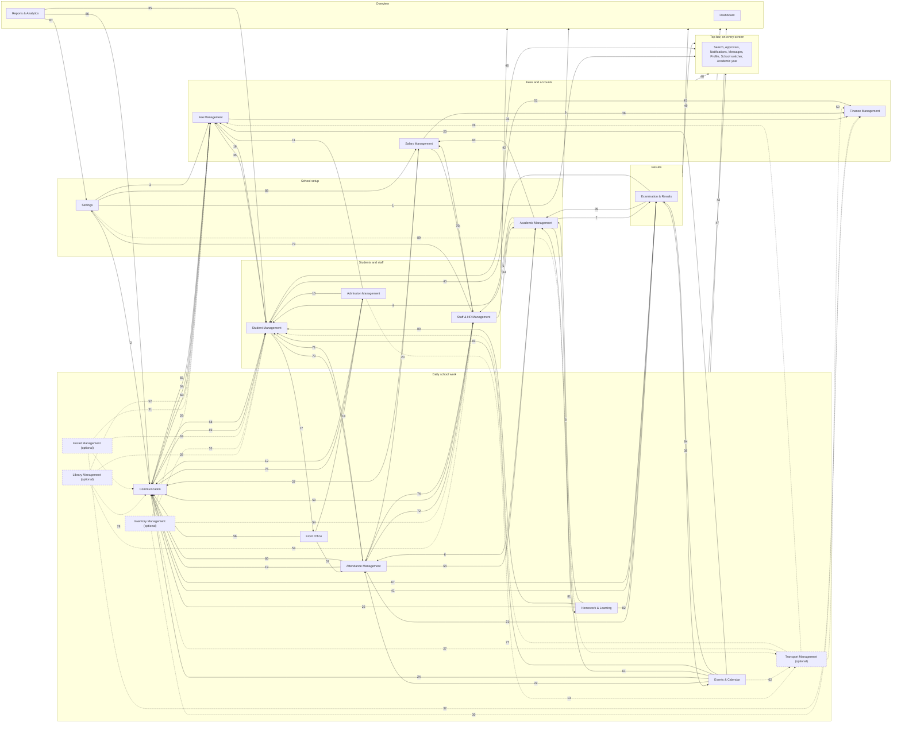

# 01. System map

This page shows School OS as one system. It has the 20 menu items, called modules, and the top bar that sits on every screen. It shows how information entered in one module reaches the others by itself.

## How to read the map

- Each box is one module from the menu. The names are exactly the names in the plan.
- The boxes sit in six layers, from setting up the school to seeing the whole picture.
- Each arrow shows information moving from one module to another. Nobody types it twice.
- The number on each arrow matches a row in the table below the map. The map has 89 numbered arrows. Every flow between modules described in a module spec has one (decided 9 October 2026).
- An arrow that starts or ends on a whole layer means "every module in that layer".
- Boxes marked "optional" with a dashed border are switched on only by schools that need them, in Settings, Modules On/Off.
- One Student record and one Staff record are shared by every module. The map shows where information moves or changes, not every place a record is read.

## The six layers and the top bar

| Layer | Modules | What it is for |
|---|---|---|
| School setup | Settings, Academic Management | The school, its users and roles, the academic year, classes, subjects and the Time Table. Everything else stands on this. |
| Students and staff | Admission Management, Student Management, Staff & HR Management | Who is in the school, from the first enquiry or the joining day to leaving. |
| Daily school work | Attendance Management, Homework & Learning, Communication, Front Office, Events & Calendar, Transport Management *(optional)*, Library Management *(optional)*, Inventory Management *(optional)*, Hostel Management *(optional)* | The work of each school day. |
| Fees and accounts | Fee Management, Finance Management, Salary Management | Every rupee that comes in or goes out. |
| Results | Examination & Results | Exams from the Datesheet to the report card. |
| Overview | Dashboard, Reports & Analytics | Today's numbers, what needs attention, and every report. |
| Top bar | Search, Approvals, Notifications, Messages, Profile, School switcher, Academic year | On every screen, not in the menu. |

## The map

Dotted arrows start or end at an optional module. They work only when the school has switched that module on.

## Every arrow, in plain words

| # | From | To | What moves |
|---:|---|---|---|
| 1 | Settings | Top bar | Roles and approval limits in Users & Permissions decide each person's menu, what Search shows them, and what reaches their Approvals list. |
| 2 | Settings | Communication | SMS, WhatsApp and email are connected once in Settings, with their message credits. Every message uses them. The school's SMS DLT entity ID and sender header, and the consent texts shown on Parent Link, also come from Settings (decided 9 October 2026). |
| 3 | Settings | Fee Management | Payment gateways connected in Settings take online fee payments. Razorpay is the first gateway (decided). The school's GSTIN and the tax invoice design also come from Settings (decided 9 October 2026). |
| 4 | Academic Management | Student Management | The academic year, classes and sections give every student a class, a section and a roll number for the year. |
| 5 | Academic Management | Staff & HR Management | Classes and subjects are the choices in step 3 of Add Staff. Each teacher's Time Table shows on their Staff Profile. |
| 6 | Academic Management | Attendance Management | Sections, school timings and periods decide which attendance registers open each day. |
| 7 | Academic Management | Examination & Results | Each class's subjects become the subjects of the Datesheet and the columns of Marks Entry. |
| 8 | Academic Management | Homework & Learning | Teacher Allocation decides which classes and subjects each teacher can give homework to. |
| 9 | School setup layer | Overview layer | Setup steps not yet done show in Needs Attention on the Dashboard. |
| 10 | Admission Management | Student Management | An approved admission creates the student, the guardian link, the admission number, class, section, roll number and ID card, and a student login where the school gives students logins. |
| 11 | Admission Management | Fee Management | An approved admission sets up the student's fee plan for the year without typing again. |
| 12 | Admission Management | Communication | Follow-up messages to enquiring families, the WhatsApp auto-reply and admission messages go out through Communication. Each new guardian gets their Parent Link. |
| 13 | Admission Management | Transport Management *(optional)* | When Transport is on, the bus stop chosen during admission is given to the new student. |
| 14 | Staff & HR Management | Academic Management | New teachers become available for Teacher Allocation, class teacher and the Time Table. Approved teacher leave asks for substitutes for that teacher's periods. |
| 15 | Staff & HR Management | Salary Management | Each staff member, and their approved leave, reach the month's salary. |
| 16 | Student Management | Fee Management | Each student's class and category pick the right Fee Structure. Year-end promotion brings the new year's fees. |
| 17 | Student Management | Front Office | Each student's guardians on the approved pickup list decide who may take the child home early with a gate pass. |
| 18 | Front Office | Admission Management | A walk-in or phone enquiry at the front desk appears in Enquiries with an owner and a follow-up reminder. |
| 19 | Attendance Management | Communication | Parents of absent students get one message. |
| 20 | Attendance Management | Salary Management | Staff attendance, late coming and overtime feed the month's salary. |
| 21 | Attendance Management | Examination & Results | Each student's attendance is printed on the report card. |
| 22 | Events & Calendar | Attendance Management | A holiday on the School Calendar switches attendance off for that day, and reports leave the day out. |
| 23 | Events & Calendar | Fee Management | Event payments are collected and receipted through Fee Management. |
| 24 | Events & Calendar | Communication | Event and PTM reminders go to parents and staff. |
| 25 | Homework & Learning | Communication | Students are told when homework is set, and pending-homework reminders go to parents. |
| 26 | Transport Management *(optional)* | Fee Management | Giving a student a bus stop adds that stop's transport fee to the student's fees. |
| 27 | Transport Management *(optional)* | Communication | Pickup, drop and "bus arriving" messages go to parents of the route. |
| 28 | Library Management *(optional)* | Student Management | Books still issued to a student must come back before the TC can be printed. |
| 29 | Inventory Management *(optional)* | Fee Management | Books and uniforms given to a student at the store counter add the charge to the student's fees. |
| 30 | Inventory Management *(optional)* | Finance Management | Purchase bills and payments to vendors are recorded in Finance Management. |
| 31 | Hostel Management *(optional)* | Fee Management | Hostel fees set in Hostel Settings are charged through Fee Management. |
| 32 | Hostel Management *(optional)* | Finance Management | Mess expenses go into Finance Management, Expenses. |
| 33 | Fee Management | Finance Management | Every fee payment, cancellation and refund makes its own Day Book entry. Receipts brought in from old software are never posted again. |
| 34 | Fee Management | Communication | Receipts, payment links, due-date reminders and late-fee notices go to parents. |
| 35 | Fee Management | Student Management | Fee dues must be cleared before the TC can be printed. |
| 36 | Salary Management | Finance Management | Salary goes into the Day Book when the payroll run is marked Paid, and a salary advance when it is paid out (decided 9 October 2026). |
| 37 | Salary Management | Communication | Staff are told when their salary slips are ready. |
| 38 | Examination & Results | Events & Calendar | A published Datesheet puts the exam days on the School Calendar. Results are shown at the PTM. |
| 39 | Examination & Results | Academic Management | A published Datesheet shows the exams in the Time Table. |
| 40 | Examination & Results | Student Management | Final results decide who is promoted at year end. Marks and report cards show on each Student Profile. |
| 41 | Examination & Results | Communication | Exam reminders go to parents, and parents are told on result day. |
| 42 | Students and staff layer | Overview layer | New admissions, pending applications, staff on leave and birthdays feed the Dashboard and the reports. |
| 43 | Daily school work layer | Overview layer | Attendance, absent students, buses, visitors, events and homework feed the Dashboard and the reports. |
| 44 | Fees and accounts layer | Overview layer | Today's collection, overdue fees, expenses and salary feed the Dashboard and the reports. |
| 45 | Results layer | Overview layer | Marks and results feed Analytics, Early Warnings and the reports. |
| 46 | Students and staff layer | Top bar | Admissions, certificates and staff leave wait in Approvals. Staff documents about to expire give a Notification. |
| 47 | Daily school work layer | Top bar | Student leave, attendance corrections, notices and purchase requests wait in Approvals. Students below 75% attendance, driver licences and bus papers about to expire, warranties and low stock give a Notification. |
| 48 | Fees and accounts layer | Top bar | Discounts, refunds, large expenses and the month's salary wait in Approvals. Failed online payments give a Notification. |
| 49 | Results layer | Top bar | Changes to marks after they are locked wait in Approvals. |
| 50 | Transport Management *(optional)* | Finance Management | Fuel and repair bills for each vehicle are recorded as Expenses, tagged to the vehicle. |
| 51 | Student Management | Finance Management | Alumni donations are recorded as Income with a receipt (optional). |
| 52 | Library Management *(optional)* | Fee Management | Library fines and lost-book charges for a student are added to the student's fees as their own rows. |
| 53 | Library Management *(optional)* | Staff & HR Management | Books still issued to a leaving staff member show in their exit clearance. |
| 54 | Inventory Management *(optional)* | Staff & HR Management | Assets and items held by a leaving staff member show in their exit clearance. |
| 55 | Inventory Management *(optional)* | Student Management | Items issued to a leaving student show in their leaving clearance. |
| 56 | Front Office | Communication | Visitor arrival and appointment confirmation messages, pickup code messages and complaints (as queries) go through Communication. |
| 57 | Front Office | Attendance Management | The time a student is picked up early is recorded on that day's attendance. |
| 58 | Student Management | Communication | Incident messages to parents, sharing of student logins, and resending or revoking a Parent Link and sending consent requests go through Communication. |
| 59 | Staff & HR Management | Communication | New staff get their invite with a login link through Communication. |
| 60 | Academic Management | Salary Management | Substitution counts reach the month's salary, where the school pays for extra periods. |
| 61 | Events & Calendar | Academic Management | Holidays and events on the School Calendar adjust the Time Table for those days. |
| 62 | Events & Calendar | Transport Management *(optional)* | No bus trips are planned on a school holiday. |
| 63 | Hostel Management *(optional)* | Student Management | Hostel details and incidents show on the student's profile, and the bed must be cleared before the student leaves. |
| 64 | Attendance Management | Academic Management | Teachers marked absent today raise substitution needs for their periods. |
| 65 | Fee Management | Communication | Parent Link shows each guardian's fees due, receipts and tax invoices, with a Pay button (decided 9 October 2026). |
| 66 | Attendance Management | Communication | Parent Link shows each child's attendance this month (decided 9 October 2026). |
| 67 | Examination & Results | Communication | Parent Link shows the published datesheet and report cards once published (decided 9 October 2026). |
| 68 | Communication | Fee Management | A payment started from Parent Link through Razorpay is recorded in Fee Management with its receipt (decided 9 October 2026). |
| 69 | Communication | Student Management | Consent given or withdrawn on Parent Link, with the text version and a one-time code, is kept with the guardian and child, along with the Parent Link's status and last opened date (decided 9 October 2026). |
| 70 | Student Management | Attendance Management | Students' RFID card numbers reach the attendance devices (optional). |
| 71 | Attendance Management | Student Management | Each student's attendance and attendance % show on the Student Profile. |
| 72 | Attendance Management | Staff & HR Management | Each staff member's attendance and late marks show on their Staff Profile. |
| 73 | Staff & HR Management | Settings | Adding a staff member creates their User Login and roles in Users & Permissions. |
| 74 | Staff & HR Management | Attendance Management | The staff list reaches Staff Attendance, and approved leave marks the person On leave. |
| 75 | Salary Management | Staff & HR Management | Salary history shows on the Staff Profile, only for people allowed to see it. |
| 76 | Communication | Admission Management | Incoming WhatsApp messages from families asking about admission reach Enquiries. |
| 77 | Transport Management *(optional)* | Student Management | Each student's route, stop and bus pass show on the Student Profile. |
| 78 | Library Management *(optional)* | Communication | "Reserved book ready" and overdue book reminders go through Communication. |
| 79 | Hostel Management *(optional)* | Communication | Outing and incident messages go to parents, and hostel complaints go to Feedback & Queries. |
| 80 | Homework & Learning | Student Management | Each student's homework shows on the Student Profile. |
| 81 | Homework & Learning | Academic Management | The AI teacher assistant drafts lesson plans for the teacher to check. |
| 82 | Homework & Learning | Examination & Results | The AI teacher assistant drafts question papers and report card remarks for the teacher to check. |
| 83 | Events & Calendar | Student Management | Achievements, houses, clubs and PTM notes show on the Student Profile. |
| 84 | Events & Calendar | Examination & Results | Co-curricular grades and achievements are printed on the report card. |
| 85 | Reports & Analytics | Student Management | Early-warning flags show on the Student Profile, and actions planned from a flag can open a counselling case. |
| 86 | Reports & Analytics | Communication | Scheduled reports are emailed through Communication. |
| 87 | Reports & Analytics | Settings | Every export is written to the export log in Settings. |
| 88 | Settings | Salary Management | The salary slip design from Document Designs is used for every payslip. |
| 89 | Settings | Transport Management *(optional)* | Driver app logins (for staff drivers and hired drivers) and the GPS provider connection come from Settings (decided 9 October 2026). |

For every arrow into Approvals, the yes or no goes back to the module that asked, and that module carries on by itself.

## What to notice

- **Communication is the one way out.** Every message to parents and staff, from any module, goes through Communication. It respects opt-outs, avoids sending the same message twice and keeps the delivery status.
- **The Day Book fills itself.** Fees, refunds, other income, expenses and salary all reach Finance Management, Day Book. Expenses, salary and salary advances arrive when they are paid. Nobody types it twice.
- **Approvals is one list.** Every request that needs a yes or no, from any module, waits in the top bar until the right person decides.
- **Student Management holds the one Student record.** Admission creates it. Every other module reads it and adds to it. Leaving closes it but never deletes it.
- **Optional modules only add.** Transport, Library, Inventory and Hostel plug into Fee Management, Finance Management and Student Management. A school without them loses nothing else.

## Decisions that touch this map

| Decision | Decided | Arrows it touches |
|---|---|---|
| Which online payment gateway to connect first | Razorpay. Cash and UPI at the counter work from the first day. | 3 |
| Can staff delete a fee payment? | No. A wrong payment is cancelled with a reason and stays on record. | 33 |
| Is Transport in the first version a school can buy? | No. Transport is the first module built after the rest. | 13, 26, 27 |
| Parent app or login? (D4, decided 9 October 2026) | No parent login. A Parent Link page, owned by Communication, is in the first sellable version. | 12, 58, 65, 66, 67, 68, 69 |
| When do salary and expenses reach the Day Book? (D12, decided 9 October 2026) | When marked paid. | 36, 50 |
| Phone apps (D11, decided 9 October 2026) | Transport comes with a small native Android driver app. | 89 |

## Not on this map

These are not part of School OS: a Safety & Health module, a parent portal with a login, and a School Website. Parents get WhatsApp, SMS and email messages, fee payment links and their Parent Link page, but they have no login. A full parent app is planned as the first thing after Stage 4 and is not specified yet (decided 9 October 2026). Above every school sits the Super Admin console (`07-super-admin.md`), used only by DREAM TEAM SERVICES to add schools and their first admin. It sees counts, never student or fee details.
