# 02. Workflows: how real school work flows through School OS

This page follows 15 pieces of real school work from start to finish. Each one shows who does what, what the software does by itself, what could go wrong, and which records change. Record names are the ones in `04-data-model.md`.

## Before you read

- **Parents have no login.** There is no parent app or parent portal. A parent acts by visiting the school, calling, sending a WhatsApp message, or opening their **Parent Link** (decided 9 October 2026): one secure link, no password, where they see fees due and pay, download receipts, and see attendance, notices, the datesheet and report cards, and give consent. The school reaches parents by WhatsApp, SMS or email through Communication.
- **"Automatic"** marks a step the software does by itself. Nobody types it.
- **Approvals** means the one Approvals list in the top bar. Who approves what, and up to which amount, is set in Settings, Forms & Approvals. Where this page says "the principal approves", that is the usual default.
- **Every diagram** has one lane (box) per person: Parent, Office Staff or Receptionist, Accountant, Teacher, Principal and Software. The **Office Staff** lane is the Office Staff role template (or the Exam In-charge for exams); the **Receptionist** lane is the Receptionist / Front Office role. What each may do is in `05-roles.md`. A workflow shows only the lanes it uses. Two workflows need one more lane: Homework has a Student lane, and the Transport trip has a Driver or Transport In-charge lane.
- In the tables, **prevents** is how the software stops the mistake, **explains** is what it tells the person in plain words, and **recover** is how people put it right. Example screen messages are shown in quotes.

## The 15 workflows at a glance

| # | Workflow | When it starts | Main people | Modules used |
|---:|---|---|---|---|
| 1 | Enquiry to admitted student | A family asks about admission | Parent, Receptionist, Principal, Accountant | Front Office, Admission Management, Student Management, Fee Management, Communication |
| 2 | Fee collection at the counter | A parent comes to pay | Parent, Accountant | Fee Management, Finance Management, Communication |
| 3 | Online fee payment | A parent opens a payment link or their Parent Link | Parent, Accountant | Fee Management, Settings, Finance Management, Communication |
| 4 | Fee reminders and defaulters | A due date comes near or passes | Accountant, Principal, Parent | Fee Management, Communication, Dashboard |
| 5 | Daily attendance and absence alert | Every school morning | Class teacher, Parent, Principal | Attendance Management, Communication, Dashboard |
| 6 | Student leave | A parent tells the school the child will be away | Parent, Office Staff, Class teacher, Principal | Attendance Management |
| 7 | Staff leave and substitution | A teacher needs leave | Teacher, Principal, Office Staff | Staff & HR Management, Academic Management, Salary Management |
| 8 | Datesheet to admit card to marks to report card | Weeks before each exam | Exam In-charge (Office Staff), Teachers, Principal, Parent | Examination & Results, Events & Calendar, Academic Management, Communication |
| 9 | Homework set, submit and grade | A teacher gives homework | Teacher, Student, Parent | Homework & Learning, Communication |
| 10 | Monthly salary run | End of each month | Accountant, Principal, Staff | Salary Management, Attendance Management, Staff & HR Management, Finance Management |
| 11 | Year-end promotion | After final results | Office Staff, Class teacher, Principal, Accountant | Student Management, Academic Management, Examination & Results, Fee Management |
| 12 | Student leaving with a TC | A parent asks for a TC | Parent, Office Staff, Accountant, Principal | Student Management, Fee Management, Library Management |
| 13 | Expense entry | The school pays a bill | Accountant, Principal | Finance Management |
| 14 | Transport morning trip *(optional module)* | Each school morning | Driver, Transport In-charge, Parent | Transport Management, Communication |
| 15 | Switching to School OS | A new school's first sign-in, on any day of the year | School Admin, Office Staff, Accountant, Principal, Parent | Settings, Academic, Staff & HR, Student, Fee, Finance, Admission Management, Communication, Dashboard |

---

## 1. Enquiry to admitted student

| | |
|---|---|
| **When it starts** | A family walks in, calls, sends a WhatsApp message or is referred, asking about admission. |
| **Who is involved** | Parent, Receptionist and the staff member who owns the enquiry (Receptionist or Admission Counsellor), Accountant, Principal, Software. |
| **Modules used** | Front Office, Admission Management, Student Management, Fee Management, Communication. |

### Steps

1. The parent visits, calls or sends a WhatsApp message.
2. The receptionist adds the enquiry in Front Office, Enquiries & Calls: the child's name, the parent's name, phone number, class wanted and where they heard of the school. Where the school has connected WhatsApp, WhatsApp enquiries arrive by themselves.
3. **Automatic:** The enquiry appears in Admission Management, Enquiries, with an owner and a follow-up date. The owner gets a reminder on that date.
4. **Automatic:** If the WhatsApp auto-reply is switched on in Admission Settings, the family gets a reply at once.
5. The owner calls the family, writes notes and sets the next follow-up, until the family decides. If the family does not join, the owner closes the enquiry with a reason.
6. The family fills the admission form. The office enters it in Applications, with the previous school and marks. Schools that take applications online can let families fill it online.
7. **Automatic:** The application gets its own application number.
8. If the school charges an application fee, the accountant collects it. **Automatic:** a receipt is made only after the payment is confirmed, and the money goes into the Day Book under Other fee types, "Application fee" (added 18 October 2026).
9. The office uploads the birth certificate, TC, marksheets and other papers, and ticks each one against the list for that class in Documents & Verification.
10. Schools with an entrance test or interview record the date, score and remarks in Test & Interview *(optional)*.
11. The principal approves or rejects the application with remarks in Admission Decision. It also waits in Approvals. If seats are full, the child goes on the waiting list. Schools that give offer letters print one here.
12. When the family accepts, the office confirms the admission.
13. **Automatic:** The software creates the Student record with an admission number, class, section and roll number. It links the parents as Guardians, or links the child to an existing Guardian if a brother or sister already studies here (the phone and the name must match; added 18 October 2026: a phone on record under another name is asked about first, "Same family" or "A different family"). It turns the papers checked in step 9 into the student's documents, with the photo, and keeps the previous school's last class and marks. It sets up the year's fee plan, makes the ID card ready to print, makes a student login where the school gives students logins, and gives the bus stop chosen during admission when Transport is on.
14. **Automatic:** The admission message goes to the parent through Communication. The Admission Dashboard and the Dashboard numbers go up.
15. The parent pays the first fees at the counter (workflow 2) or by payment link (workflow 3).

### What could go wrong

| What could go wrong | How the software prevents it | How it explains it | How people recover |
|---|---|---|---|
| The same family enquires twice | Warns about a matching phone number or email when the enquiry is added | "An enquiry with this phone number already exists, for Class 1, owned by the admission desk." | Open the existing enquiry and add to it. |
| A follow-up is forgotten | Reminds the owner on the date and highlights overdue follow-ups | Overdue follow-ups stand out on the Enquiries list and the Admission Dashboard. | Reassign the enquiry to another staff member. The history of who owned it is kept. |
| A required paper is missing | The list of papers for the class shows a status for each one | "Birth certificate: not checked yet." | Upload and check it later. The application waits. |
| Seats are full | Seat rules in Admission Settings | Shows the seats left in each section. | Put the child on the waiting list. Every change to the rank is logged. |
| A child is entered twice as a student | An application turns into a student only once. A duplicate check runs on name, date of birth, guardian and phone. | "A student with this name, date of birth and parent phone already exists in Class 3 A." | Link to the existing student instead. |
| The wrong section is given | The decision screen shows the class and section before confirming | | Change the section on the Student Profile. The change is kept in the audit log. |
| The family's phone is already on record under another parent's name (added 18 October 2026) | Confirm admission asks before linking anyone | "Phone 98765 43210 is already on record for Ravi Kumar (parent of Arjun Kumar), not for Suresh Babu named on this form. Say whether this is the same family." | Choose "Same family" to link that parent, or "A different family" to add a new parent with the phone. |
| The admission was confirmed by mistake | Undo admission for 10 minutes, while nothing else has happened to the student | "A fee payment is already recorded for this student, so the admission cannot be undone." | Undo takes back the student, new parents, Parent Links, class place, fee plan and documents; later, record the student leaving. |

### Records created or changed

- **Created:** Enquiry, Application, Approval, Student, Enrolment, Guardian (or a new link to an existing Guardian), Student Fee Due for each installment, Student Document for each verified paper, Message, Notification. Where used: the application fee payment with its receipt number, and its Day Book Entry; User Login for the student; Transport Assignment.
- **Changed:** Enquiry (status becomes joined or lost), Application (decision), Audit Log Entry for every step.

### Diagram

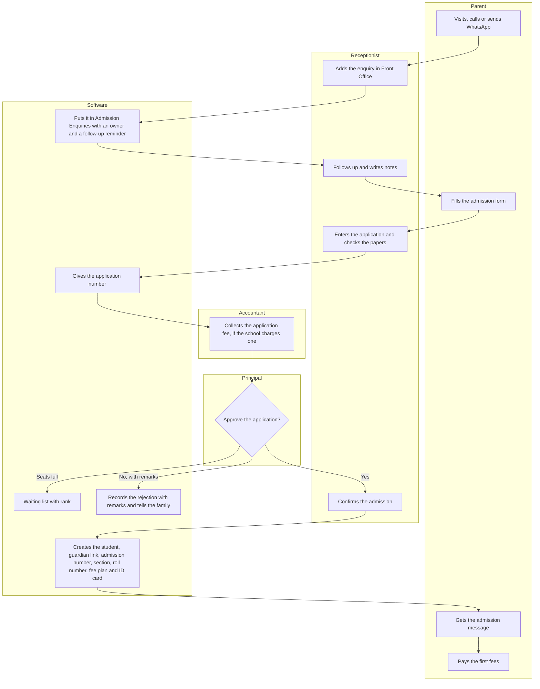

---

## 2. Fee collection at the counter

| | |
|---|---|
| **When it starts** | A parent comes to the fee counter to pay. |
| **Who is involved** | Parent, Accountant, Principal (only for a discount above the limit), Software. |
| **Modules used** | Fee Management, Finance Management, Communication, Dashboard. |

### Steps

1. The parent comes to the counter.
2. The accountant opens Collect Fee and finds the student by name, admission number, phone or class. Typing "fee Ravi" in Search opens the same page.
3. **Automatic:** The software shows the student's photo, class, section and father's name, every fee due by fee head and installment, any late fee, and the total to pay.
4. The accountant picks the installments being paid and enters the amount. It can be the full amount or a part.
5. The accountant picks the mode: cash, UPI, card, cheque, net banking or bank transfer, and types the reference number for anything that is not cash.
6. If the parent asks for a discount, the accountant can give one at the counter only if their role allows it, with a reason. Above the limit set in Settings, Forms & Approvals, it goes to the principal in Approvals.
7. The accountant checks the summary on screen and confirms.
8. **Automatic:** All of these happen together: the Payment is saved, the receipt gets its number and is ready to print (office copy and parent copy), the student's balance goes down, a Day Book entry is made, the Fee Dashboard and Dashboard update, and the parent gets the receipt on WhatsApp.
9. The parent takes the printed receipt.
10. At the end of the day, the accountant matches the Day Book totals for each mode with the cash in hand, in Finance Management, Cash & Bank.

### What could go wrong

| What could go wrong | How the software prevents it | How it explains it | How people recover |
|---|---|---|---|
| The wrong student is picked | Search results show photo, class, section and father's name. The summary shows the name again before saving. | | Cancel the payment with a reason (see the last row) and collect again from the right student. |
| The amount is more than the due | Blocked, unless the school allows advance payments in Fee Settings | "₹10,000 is more than the ₹8,000 due. Advance payments are off in Fee Settings." | Enter the right amount. |
| A discount is given without permission | Only allowed roles see the discount option. Above the limit it goes to Approvals. | "Discounts above the limit need the principal's approval. Sent to Approvals." | Take the payment without the discount, or wait for the decision. |
| A payment is saved by mistake | One confirmation screen shows student, amount and mode before saving | | Cancel it with a reason. The receipt is marked cancelled, the balance goes back, the Day Book gets a reversing entry, and the audit log records who did it and why. The payment cannot be deleted. |
| The cash does not match at day end | The Day Book shows every payment with time, mode and who collected it. The cash book shows opening and closing balance. | | Find the payment in the Day Book and correct it by cancelling with a reason. |
| The WhatsApp receipt does not reach the parent | Message History shows sent, delivered, read or failed | "Failed: number not on WhatsApp." | Retry the message (a set number of times) or print another copy of the receipt. |

> **Decided:** Staff can never delete a fee payment. A wrong payment is cancelled with a reason and stays on record, so receipts, balances and the Day Book always match.

### Records created or changed

- **Created:** Payment, Receipt, Day Book Entry, Message, Audit Log Entry. For a discount: Concession and Approval.
- **Changed:** Student Fee Due (amount paid, balance, status).

### Diagram

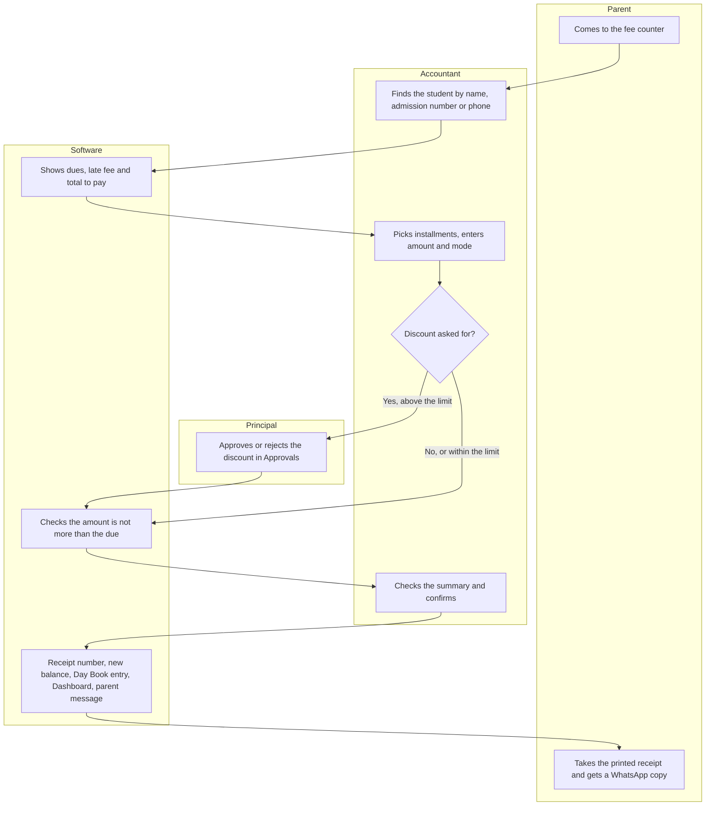

---

## 3. Online fee payment

| | |
|---|---|
| **When it starts** | A parent opens a payment link sent by WhatsApp, SMS or email, or taps Pay on their Parent Link. |
| **Who is involved** | Parent, Accountant, Software, and the payment gateway (the outside company that takes the money). |
| **Modules used** | Fee Management, Settings (Payment Gateways), Finance Management, Communication. |

### Steps

1. A payment link reaches the parent. It goes out with a fee reminder (workflow 4), or the accountant sends it from the Defaulters list or the Student Fee Ledger. It shows the student's name and the amount due.
2. The parent opens the link and pays by UPI, card or net banking on the gateway's page.
3. **Automatic:** The software waits for the gateway to confirm the payment. It does not post the payment just because the parent's screen says "success".
4. **Automatic:** When the gateway confirms, the payment is posted once and matched to the student's dues. The receipt gets its number, the balance goes down, the Day Book gets an entry under online fees, the parent gets the receipt on WhatsApp, and the payment appears in Recent Payments on the Fee Dashboard.
5. Schools that check online payments before posting switch this on in Fee Settings. Then the accountant approves each one in Recent Payments before step 4 happens.
6. **Automatic:** If the payment fails, no receipt is made. The failed payment is flagged on the Fee Dashboard. The parent can try again.
7. The accountant looks at failed and waiting payments on the Fee Dashboard each day.

### What could go wrong

| What could go wrong | How the software prevents it | How it explains it | How people recover |
|---|---|---|---|
| The gateway sends the same confirmation twice | A payment is never posted twice | | Nothing to do. |
| Money leaves the parent's account but the confirmation is late | Nothing is posted and no receipt is made until the gateway confirms | The payment shows as waiting on the Fee Dashboard. | Automatic matching posts it as soon as the gateway confirms. The accountant can check the list. |
| The parent pays the same dues twice | The link always shows the current due. A link that is already paid cannot be paid again. | The extra payment shows on the student's ledger. | Refund it with a reason and approval, or keep it as advance where the school allows advance payments. |
| The wrong gateway is used for a class | Fee Settings says which gateway each class uses | | Change the choice in Fee Settings. |
| The gateway is not connected properly | Settings, Payment Gateways has a test button before going live | "Test connection failed. Check the merchant key." | Fix the details and test again. Cash and UPI at the counter keep working. |

> **Decided:** Razorpay is the first online payment gateway. It is already active in the demo school and most Indian schools know it. PhonePe and Easebuzz follow one by one.

### Records created or changed

- **Created:** Payment Link, Payment, Receipt, Day Book Entry, Message, Audit Log Entry. On failure: Notification. If paid twice: Refund and Approval.
- **Changed:** Payment Link (status paid or failed), Student Fee Due (amount paid, balance, status).

### Diagram

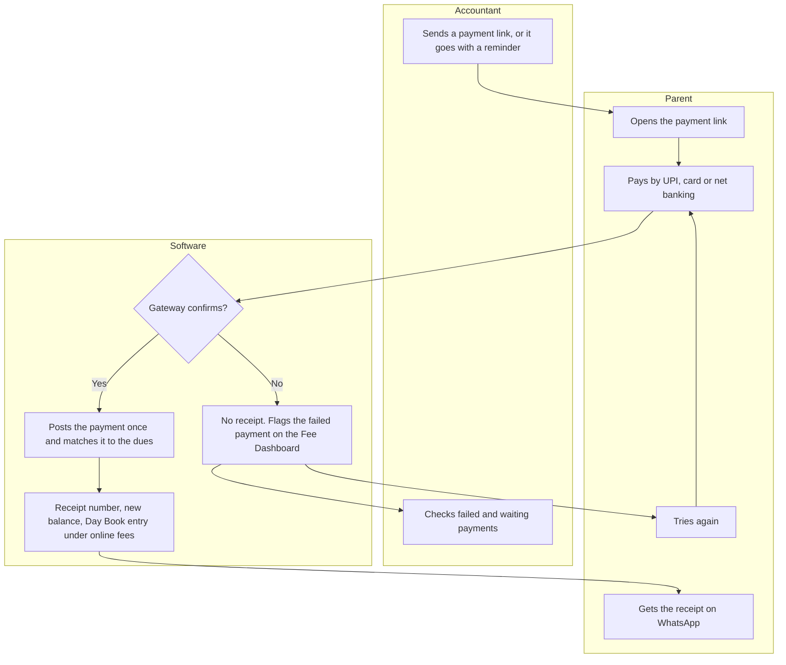

---

## 4. Fee reminders and defaulters

| | |
|---|---|
| **When it starts** | On the days set in Fee Settings before and after each due date. Also whenever the accountant opens Defaulters. |
| **Who is involved** | Software, Parent, Accountant, Principal. |
| **Modules used** | Fee Management, Communication, Dashboard. |

### Steps

1. **Automatic:** Before each due date, on the days set in Fee Settings (for example "fee due tomorrow"), a reminder goes to parents whose child still owes that installment. It uses the chosen template and channel, carries a payment link, and skips parents who opted out.
2. **Automatic:** When the due date passes, the due becomes overdue. After the grace period, the late fee from Fee Settings is added.
3. **Automatic:** The Defaulters list updates with each student, the amount, how long it is overdue and the reminders already sent. Overdue fees appear in Needs Attention on the Dashboard for the principal and the accountant.
4. The accountant opens Defaulters, filters by class or by how long overdue, and sends one reminder to everyone on the list in one go. Before sending, the software shows how many parents, a preview and the cost in message credits.
5. The accountant calls the families with the oldest dues.
6. The parent pays at the counter (workflow 2) or by the link (workflow 3). **Automatic:** the student leaves the Defaulters list and reminders for that installment stop.
7. If a parent asks for the late fee to be waived, the accountant records a waiver with a reason. Above the limit, the principal decides in Approvals.

### What could go wrong

| What could go wrong | How the software prevents it | How it explains it | How people recover |
|---|---|---|---|
| A reminder goes to a parent who already paid | Reminders read the balance at the moment of sending | | Nothing to do. |
| A parent gets the same reminder twice | Automatic messages never repeat for the same event | | Nothing to do. |
| A template has a missing blank, such as the due amount | Sending is blocked | "This template needs the due amount. Fill it before sending." | Fix the template in Message Templates. |
| Not enough message credits | The cost is shown before sending | "This needs 1,240 credits. You have 900." | Add credits (balance in Settings, SMS, WhatsApp & Email) or choose another channel. |
| A late fee is added by mistake | One late fee rule, with a grace period, set in Fee Settings | The late fee shows as its own line on the due. | Waive it with a reason. Above the limit it needs approval. The change is in the audit log. |
| A parent has opted out of messages | Opt-outs are respected, except for emergency messages | The preview shows how many parents are skipped and why. | Call the parent. |
| A message fails | Message History keeps the status of every message | "Failed" | Retry, up to the set limit. |

### Records created or changed

- **Created:** Message, Payment Link, Notification. For a waiver: Concession and Approval.
- **Changed:** Student Fee Due (status overdue, late fee added), Audit Log Entry.

### Diagram

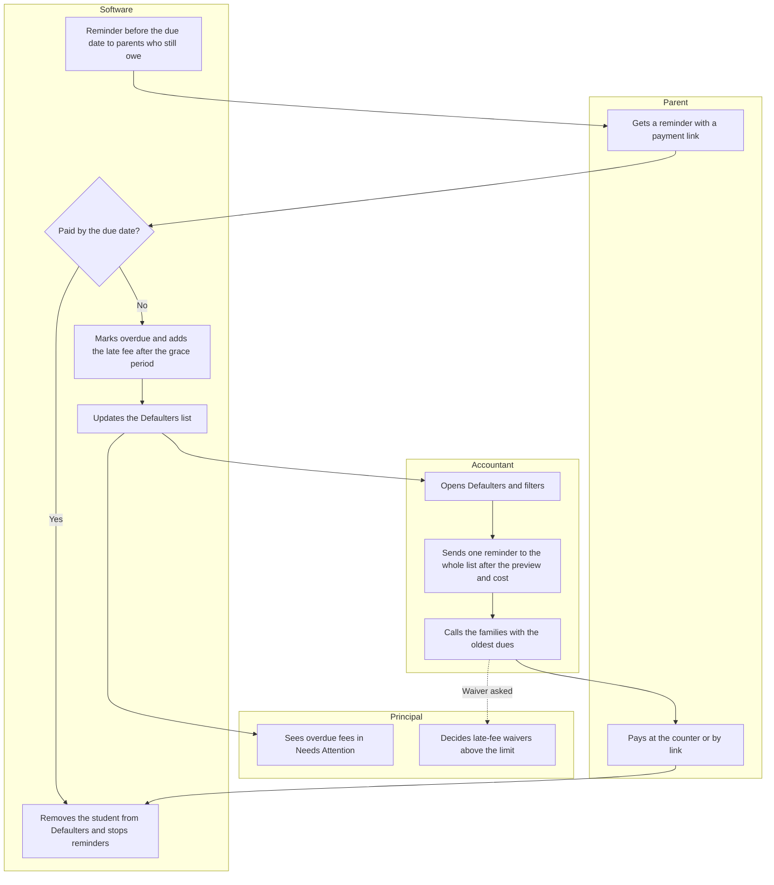

---

## 5. Daily attendance and absence alert

| | |
|---|---|
| **When it starts** | Every school morning in the first period. In schools that take attendance every period, in each period. |
| **Who is involved** | Class teacher (Teacher), Parent, Principal, Software. |
| **Modules used** | Attendance Management, Communication, Dashboard, Events & Calendar. |

### Steps

1. The class teacher opens the home screen. Today's classes are listed, each with a Take Attendance button.
2. **Automatic:** Students on approved leave already show as "leave".
3. The teacher marks the whole class present in one tap, then changes only the absent and late students, and adds a note where needed.
4. The teacher saves. It works on a phone. Where the school uses offline mode, the marks are kept on the phone and sent when the internet returns.
5. **Automatic:** The parent of each absent student gets one message. The attendance register and the Dashboard update.
6. **Automatic:** Any student below 75% attendance is flagged to the class teacher and the principal. Students absent 3 days appear in Needs Attention.
7. **Automatic:** At the cut-off time set in Attendance Settings, the day's attendance locks.
8. If a mistake is found after the lock, the teacher asks for a correction. It waits in Approvals. The original mark stays in the audit log.
9. The principal looks at Needs Attention and Attendance Reports. Students flagged in Early Warnings are reviewed by a person before anything is done.

Schools using face, fingerprint, RFID card or QR check-in *(optional, Devices & QR)* get the same automatic steps from the device marks.

### What could go wrong

| What could go wrong | How the software prevents it | How it explains it | How people recover |
|---|---|---|---|
| A present child is marked absent | Mark-all-present first, so only the exceptions are touched | The save button shows the count, such as "32 present, 3 absent". | Change it before the cut-off. After the lock, ask for a correction through Approvals. |
| Attendance is taken on a holiday | A holiday on the School Calendar switches attendance off | "Today is a holiday on the School Calendar." | If the school opens that day, allow attendance on that date in the School Calendar. |
| A parent gets two messages for one absence | One message per absence, never repeated | | Nothing to do. |
| The internet is poor | Offline mode *(optional)* | "Saved on this phone. It will be sent when the internet returns." | It sends by itself later. |
| The teacher forgets | The class stays on the teacher's home screen with its Take Attendance button | | The teacher marks it before the cut-off. |

### Records created or changed

- **Created:** Attendance Mark for each student, Message to each absent student's parent, Notification for flags. For a correction: Approval.
- **Changed:** Attendance Mark (on correction), Audit Log Entry.

### Diagram

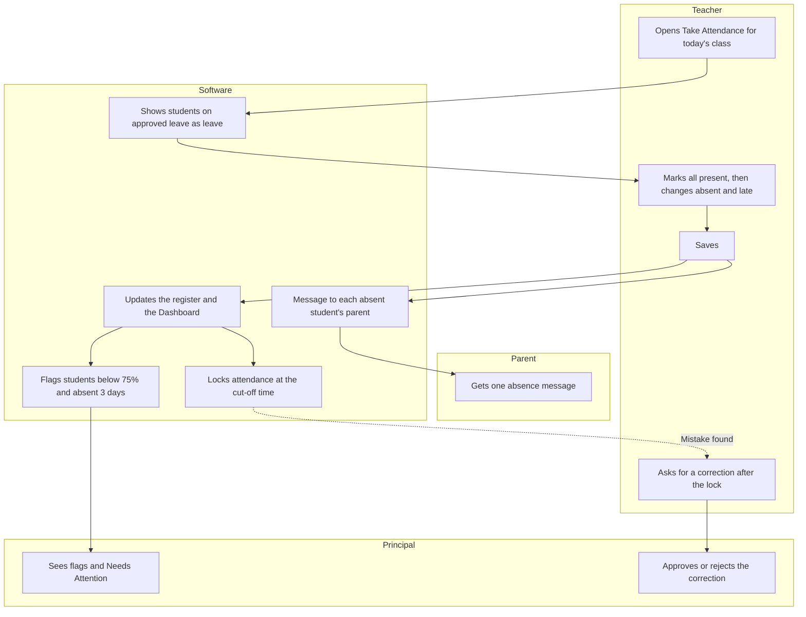

---

## 6. Student leave

| | |
|---|---|
| **When it starts** | A parent tells the school that the child will be away, or was away, by a call, a note, a WhatsApp message or at the front desk. |
| **Who is involved** | Parent, Office Staff, Class teacher (Teacher), Principal, Software. |
| **Modules used** | Attendance Management (Student Leave), Communication. |

### Steps

1. The parent tells the school. Parents have no login, so school staff record the leave.
2. The class teacher or the office records the Leave Request in Attendance Management, Student Leave: dates, type (medical, emergency or holiday), reason and any paper such as a doctor's note.
3. **Automatic:** The software checks that the dates do not overlap another leave, then sends the request to the approver set in Settings, Forms & Approvals.
4. The approver (often the class teacher for short leave, the principal for longer leave) approves or rejects with a reason.
5. **Automatic:** On approved days, the student shows as "leave" in Take Attendance and in the register. No absence message goes out for those days.
6. The office tells the parent the decision by message from Communication, if needed.
7. If those days were already marked absent, the class teacher changes them to leave. After the lock, this is a correction through Approvals.

### What could go wrong

| What could go wrong | How the software prevents it | How it explains it | How people recover |
|---|---|---|---|
| The dates overlap an existing leave | Blocked | "Ravi already has leave from 3 to 5 March." | Change the existing leave instead. |
| Leave is recorded after the day was marked absent | | The register shows the approved leave next to the absence. | Correct the mark. After the lock, a correction goes to Approvals and is logged. |
| Leave is approved with the wrong dates | | | Cancel the leave with a reason and record a new one. Both stay on record. |

### Records created or changed

- **Created:** Leave Request, Approval, Notification. If the office writes to the parent: Message.
- **Changed:** Attendance Mark (status leave), Audit Log Entry.

### Diagram

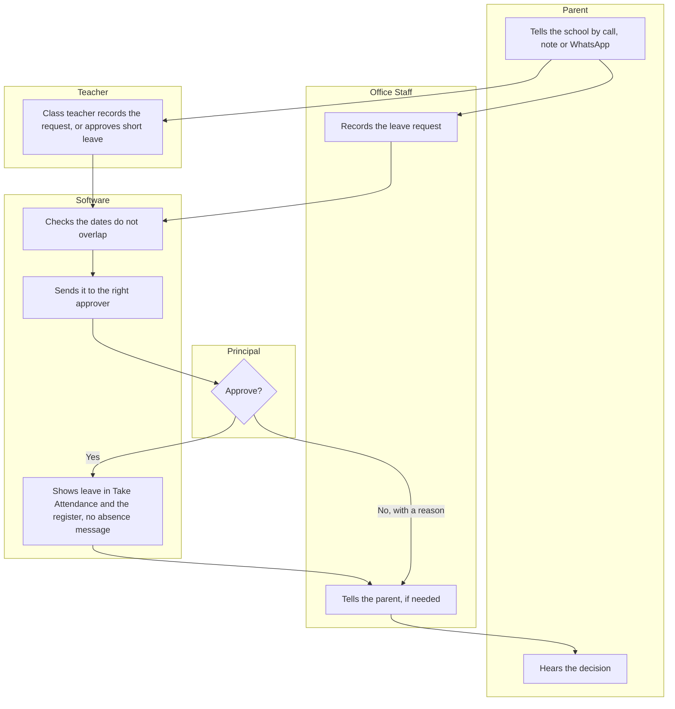

---

## 7. Staff leave and substitution

| | |
|---|---|
| **When it starts** | A teacher or staff member needs leave, planned or sudden. |
| **Who is involved** | Teacher, Principal, Office Staff (whoever arranges the Time Table), Software. |
| **Modules used** | Staff & HR Management, Academic Management (Substitutions), Attendance Management, Salary Management, Dashboard. |

### Steps

1. The teacher applies in Staff & HR Management, Staff Leave, from the phone: dates, leave type and reason.
2. **Automatic:** The software shows the leave balance and blocks dates that overlap another leave.
3. **Automatic:** The request waits in the principal's Approvals, with the leave balance and the periods that will need cover.
4. The principal approves or rejects with a reason.
5. **Automatic:** The leave balance drops, the leave calendar updates, the days show as leave in Staff Attendance, and the teacher is told.
6. **Automatic:** For each of that teacher's periods, the software suggests a substitute from the teachers who are free then. Nobody is double-booked.
7. The office confirms or changes the suggestions in Academic Management, Substitutions. For a long absence, the office can name a temporary teacher.
8. **Automatic:** The substitute teachers are told. Today's substitutions show on the Dashboard, under Today & Upcoming.
9. **Automatic:** At the month end, the leave reaches the salary (workflow 10).
10. If the leave is cancelled, the balance comes back and the substitutions for those periods are released.

### What could go wrong

| What could go wrong | How the software prevents it | How it explains it | How people recover |
|---|---|---|---|
| Not enough leave balance | The balance is shown before applying | "You have 2 casual leaves left. This request is for 3 days." | Choose another leave type. |
| The dates overlap another leave | Blocked | "You already have leave on 12 March." | Change the existing leave. |
| No teacher is free for a period | Only free teachers are suggested | The period shows as "substitute needed" on the Dashboard. | The office picks a teacher from the free periods view. |
| A teacher is booked twice | Clash check before saving | "This teacher is already teaching 7 B in period 3." | Pick another teacher. |
| Leave is approved by mistake | | | Cancel the leave with a reason. The balance comes back. Both steps are logged. |
| Leave is approved for a day already marked absent, or after that month's salary was approved | The absent mark becomes leave, so the day counts once | | Nothing to do: the next month's salary gives the loss of pay back as arrears, with the reason. |

### Records created or changed

- **Created:** Leave Request, Approval, Substitution for each affected period, Notification.
- **Changed:** Attendance Mark for the staff member (leave), leave balance on the Staff record, Audit Log Entry. Later read by the Payroll Run.

### Diagram

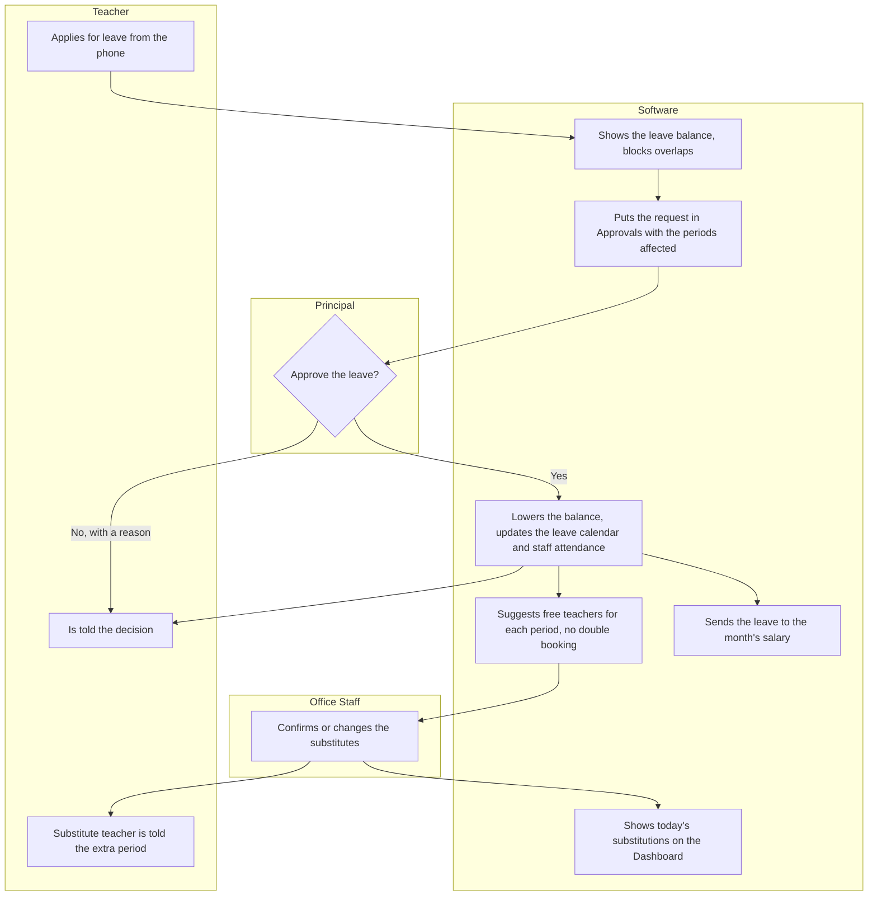

---

## 8. Datesheet to admit card to marks to report card

| | |
|---|---|
| **When it starts** | A few weeks before each exam, such as a unit test, the half-yearly or the annual exam. |
| **Who is involved** | Exam In-charge or Office Staff, Teachers, Class teachers, Principal, Parent, Software. |
| **Modules used** | Examination & Results, Events & Calendar, Academic Management, Attendance Management, Communication. |

### Steps

1. The office creates the Datesheet in Examination & Results: title, exam type, classes, start and end dates, and pattern (marks, grades or CGPA). Creating the Datesheet creates the exam.
2. The office adds each subject's date, start time, duration, maximum marks, room and invigilator. One time and one maximum can be applied to all subjects at once. The end time is shown by itself.
3. **Automatic:** The software checks that no class has two papers at once, and that no room or invigilator is booked twice.
4. The office publishes the Datesheet.
5. **Automatic:** The exam days appear on the School Calendar and in the Time Table. Admit cards are ready. Exam reminders go to parents.
6. The office prints admit cards for a whole class or for one student.
7. The exams are held. Each teacher enters marks subject by subject, on a phone or a computer, marking absent students as absent.
8. **Automatic:** As marks come in, the total, percentage, grade and rank (if the school uses ranks) are worked out using the Grade Scale.
9. Class teachers add remarks. The principal adds remarks. Where the school uses AI, it can draft remarks from the student's real marks and attendance; the teacher reads, edits and accepts each one.
10. The principal checks the class results in Results and Exam Analysis, and sets the result date.
11. **Automatic:** On the result date, the results are published, the report cards are ready (marks, grades, attendance, co-scholastic grades and remarks), and parents are told.
12. Report cards are printed and given to parents, often at the PTM.

### What could go wrong

| What could go wrong | How the software prevents it | How it explains it | How people recover |
|---|---|---|---|
| A class has two papers at the same time | Blocked | "Class 8 already has Science on 12 March at 9.00 am." | Change the date or time. |
| A room or invigilator is booked twice | Blocked | "Room 4 is already used by Class 6 at this time." | Pick another room or invigilator. |
| Marks are more than the maximum | Blocked; marks must be between 0 and the maximum | "The maximum for this paper is 80." | Enter the right marks. |
| Some marks are still missing | Results in draft cannot be published | The Results page shows the class as still in draft. | Teachers finish Marks Entry, then publish. |
| A mark is wrong after it is locked | A change needs a reason and approval, and the old value is kept | | Ask for the change. The principal decides in Approvals. The result is worked out again. |
| The grade scale is changed mid-year | Changing it never changes results already published | | Nothing to do. |
| An AI-drafted remark is wrong | AI only drafts from real records and nothing is saved until the teacher accepts | Drafts are labelled "Suggestion". | Edit or discard the draft. |

### Records created or changed

- **Created:** Exam, Datesheet Entry for each subject, Calendar Entry for exam days, Message, Marks, Result, Report Card. For a mark change: Approval.
- **Changed:** Exam (status published, results published, locked), Result (draft to published), Audit Log Entry.

### Diagram

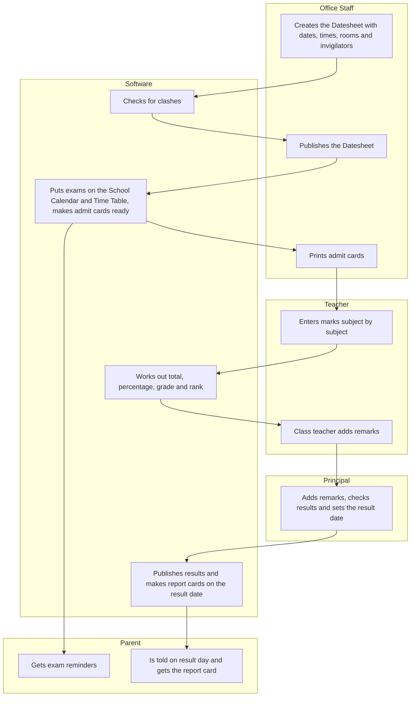

---

## 9. Homework set, submit and grade

| | |
|---|---|
| **When it starts** | A teacher gives homework during or after a class. |
| **Who is involved** | Teacher, Student, Parent, Software. |
| **Modules used** | Homework & Learning, Communication, Student Management (Student Profile). |

### Steps

1. The teacher opens Homework on the phone and picks the class, section or chosen students, and the subject. Only the teacher's own classes are offered.
2. The teacher adds a title, instructions, any attachment, the due date and the maximum marks (100 unless changed), and saves. It takes about three taps. Where the school uses AI, it can draft homework as a suggestion for the teacher to edit.
3. **Automatic:** Students are told about the homework. It shows on each Student Profile with the status "assigned".
4. Students do the work. Where the school uses online submission, students with a login hand it in online before the due date. Otherwise they hand in their notebooks.
5. **Automatic:** Online work handed in after the due date is marked late.
6. The teacher opens Submissions & Grading, sees who has handed in, marks each one complete or incorrect, and gives a score and feedback. The whole class can be updated at once.
7. **Automatic:** Statuses update to graded or missing. If the pending-homework message is on in Message Settings, parents of students who have not handed in are told. Learning Progress updates.
8. Students with a login see the feedback. They can hand in again only if the teacher allows it.

### What could go wrong

| What could go wrong | How the software prevents it | How it explains it | How people recover |
|---|---|---|---|
| Homework for a class the teacher does not teach | Only classes from Teacher Allocation are offered | | Ask the office to change Teacher Allocation if it is wrong. |
| Homework for a class with no students | Such classes are not offered | | Add students to the class first. |
| Work handed in late | Marked late by itself | The status shows "late". | The teacher can still grade it. |
| A score above the maximum | Blocked | "This homework is out of 20." | Enter the right score. |
| Too many messages to parents | The pending-homework message can be switched on or off, and is never sent twice for the same homework | | Change it in Message Settings. |

### Records created or changed

- **Created:** Homework, Submission for each student, Message, Notification.
- **Changed:** Submission (status, score, grade, feedback).

### Diagram

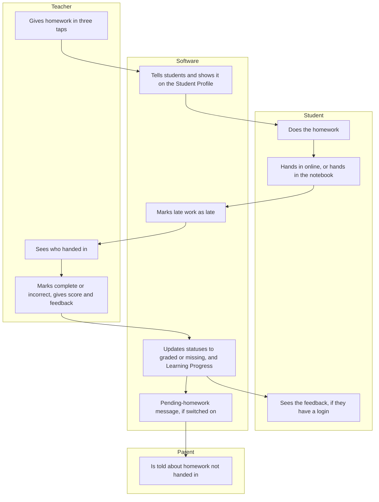

---

## 10. Monthly salary run

| | |
|---|---|
| **When it starts** | At the end of each month, on the day the school chooses. |
| **Who is involved** | Accountant, Principal, every staff member (shown in the Teacher lane), Software. |
| **Modules used** | Salary Management, Attendance Management, Staff & HR Management, Finance Management, Communication. |

### Steps

1. The accountant opens Salary Management, Generate Salary, and chooses the month.
2. **Automatic:** For each staff member, the software brings in the salary structure, days present, late coming, approved leave and overtime, and any advance or loan to recover *(optional)*. It works out gross pay, deductions and net pay.
3. The accountant checks the list and adds any bonus, arrears or extra deduction, each with a reason.
4. The accountant sends the month's salary for approval.
5. The principal looks at the totals and approves, or rejects with a reason, in Approvals.
6. **Automatic:** The salary for the month is approved and cannot be changed. Salary slips are made, with PF, ESI, Professional Tax and TDS where they apply. Each staff member is told.
7. The accountant pays the staff (bank transfer, cheque or cash) and marks the month **Paid**.
8. **Automatic:** The salary payment goes into the Day Book, because that is when money leaves (decided 9 October 2026). The month is locked. Salary History and the PF and ESI statements update.
9. Each staff member downloads their own salary slip from Salary Slips.

### What could go wrong

| What could go wrong | How the software prevents it | How it explains it | How people recover |
|---|---|---|---|
| Salary is generated twice for the same month | Only one salary run per month for each campus | "Salary for September is already generated." | Open the existing one. |
| A change is made without a reason | A reason is needed for every adjustment | "Please give a reason for this bonus." | Add the reason. |
| A mistake is found after approval | The approved month is locked | | Put it right with a reversal or an adjustment, with a reason. The locked month is not changed. |
| Leave or attendance for an approved month changes later | The month stays as it was paid | "September 2026 salary: 1 day of loss of pay given back" | The next month's salary adds the arrears or deduction by itself, with PF and ESI by the earlier month's rules. The accountant checks it before sending. |
| A salary structure changed during the month | Old versions are kept, and each slip records the version used | | Nothing is lost. |
| Someone tries to see another person's slip | Each person sees only their own slip, unless their role allows more | | |

### Records created or changed

- **Created:** Payroll Run, Payslip for each staff member, Approval, Day Book Entry, Notification.
- **Read:** Salary Structure, Attendance Mark, Leave Request.
- **Changed:** Payroll Run (Open, Calculated, Waiting for approval, Approved, Paid, Locked), Audit Log Entry.

### Diagram

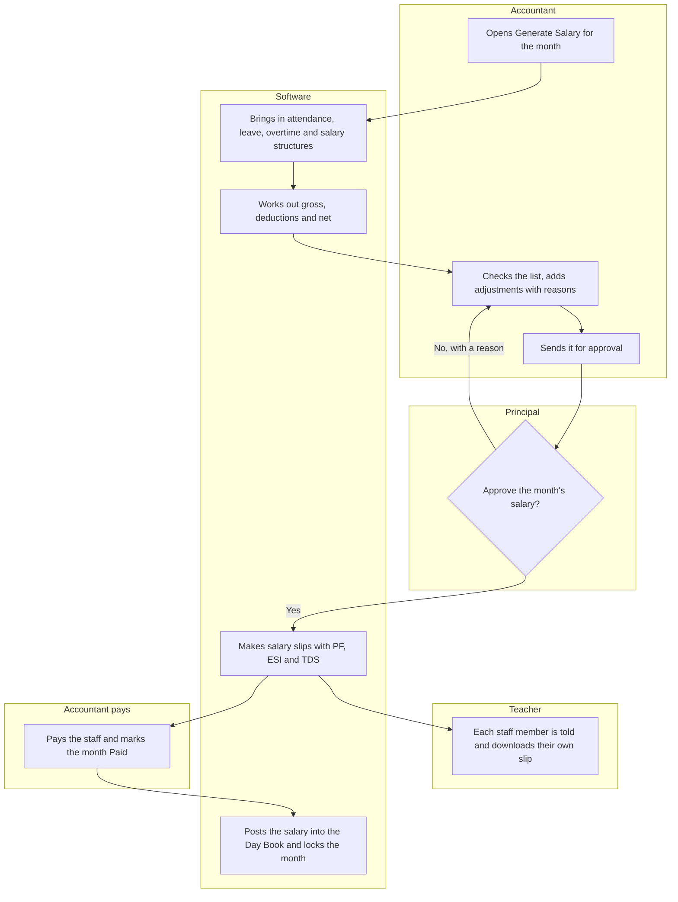

---

## 11. Year-end promotion

| | |
|---|---|
| **When it starts** | After the final results, at the end of the academic year (March in most Indian schools). |
| **Who is involved** | Office Staff or the School Admin, Class teacher (Teacher), Principal, Accountant, Software. |
| **Modules used** | Student Management (Promotion), Academic Management, Examination & Results, Fee Management. |

### Steps

1. The office opens the new Academic Year in Academic Settings, with its dates and terms. Last year stays as it is.
2. The office sets up the new year's sections and class teachers. The accountant sets the new year's Fee Structure for each class.
3. The principal publishes the final results (workflow 8).
4. The office opens Promotion for a class.
5. **Automatic:** The software proposes the next class for each student from the final results and the promotion rules in Student Settings. Students who did not meet the rules are shown for a decision.
6. The class teacher checks the list and marks any student held back, leaving, or moving to another section.
7. The principal reviews the whole list and approves it.
8. The office saves the promotion. Before saving, the software shows a preview, and after saving, a summary.
9. **Automatic:** Each student gets a new Enrolment for the new year, with the new class, section and roll number. The new year's fees are set. Any unpaid dues are carried into the new year as old dues. Last year's record is not changed.
10. When everything is done, the office closes the old year. **Automatic:** the past year opens read-only from then on.

### What could go wrong

| What could go wrong | How the software prevents it | How it explains it | How people recover |
|---|---|---|---|
| Promotion before the results are final | The list is built from published final results | "Final results for Class 5 are not published yet." | Publish the results first. |
| The new year's fees are not set | The software checks for a Fee Structure for the new class | "The Fee Structure for Class 6, 2028 to 2029, is not set yet." | The accountant sets it, then promotion continues. |
| A section gets more students than its seats | Seats per section are checked | "Section 6 A has 40 seats. 43 students are chosen." | Move some students to another section. |
| A student is promoted by mistake | Preview before saving | | Move the student on their Student Profile. Last year's record stays as it was. The change is logged. |
| Unpaid dues are forgotten | Carried into the new year by themselves | They show as old dues on the Student Fee Ledger. | Nothing to do. |

### Records created or changed

- **Created:** Academic Year, Term, Section, Enrolment for each student, Fee Structure, Installment, Student Fee Due (new fees and carried-in old dues), Approval.
- **Changed:** Enrolment for last year (status promoted, held back or left), Academic Year (old year closed), Audit Log Entry.

### Diagram

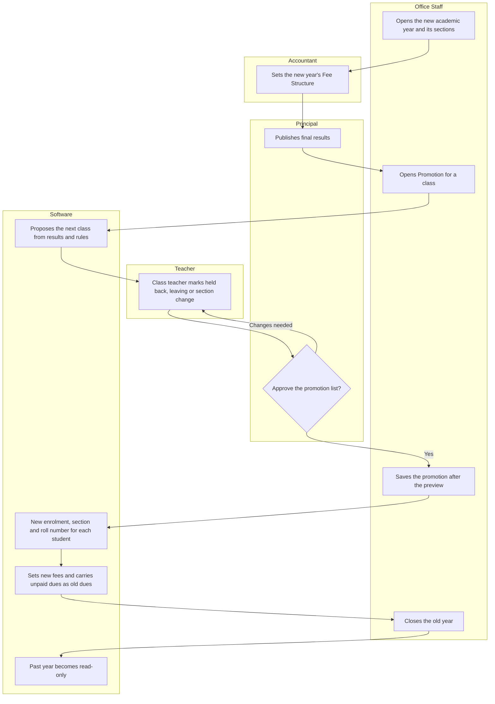

---

## 12. Student leaving with a TC

| | |
|---|---|
| **When it starts** | A parent asks for a transfer certificate (TC) because the child is changing school, or a student finishes the last class. |
| **Who is involved** | Parent, Office Staff, Accountant, Principal, Software. The librarian takes books back where Library is on. |
| **Modules used** | Student Management (Leaving & Alumni, Certificates & ID Cards), Fee Management, Library Management *(optional)*, Transport Management *(optional)*. |

### Steps

1. The parent asks the office for a TC, with the reason and the new school.
2. The office records the leaving in Student Management, Leaving & Alumni: reason, last date and the new school.
3. **Automatic:** The software checks the fee dues and, where Library is on, any books not returned. It shows exactly what is pending.
4. The accountant collects any pending fees (workflow 2), or the principal approves a concession. The librarian takes back any books.
5. **Automatic:** Clearance shows as done when the dues are zero and the books are back.
6. The office asks for the TC in Certificates & ID Cards. The request waits in the principal's Approvals.
7. The principal approves.
8. The office prints the TC in the school's design from Settings, Document Designs, with a QR code to check it where the school uses one.
9. **Automatic:** From the leaving date, the student's status becomes transferred (or withdrawn, or graduated). The student leaves the class lists, the attendance register and fee reminders. A bus seat is freed where Transport is on. A student login, if any, is switched off. The record is kept as a past student in Leaving & Alumni. Nothing is deleted.
10. The parent receives the TC.

### What could go wrong

| What could go wrong | How the software prevents it | How it explains it | How people recover |
|---|---|---|---|
| A TC is asked for while fees are pending | The TC cannot be printed until dues are cleared | "₹6,000 fee due and 1 library book not returned." | Clear the dues, return the book, or ask for a concession with approval. |
| The TC has a wrong detail | Details come from the Student record, with a preview before printing | | A correction request goes to Approvals and is logged. |
| The family changes its mind | | | Cancel the leaving request before the TC is printed. The student stays active. |
| A leaving student's record is lost | Records are never deleted, only moved to past students | | Find the student in Leaving & Alumni. |

### Records created or changed

- **Created:** Certificate, Approval. Where needed: Payment, Receipt, Day Book Entry, Concession.
- **Changed:** Student (status, leaving date and reason), Enrolment (left), Book Issue (returned), Transport Assignment (ended), User Login (switched off), Audit Log Entry.

### Diagram

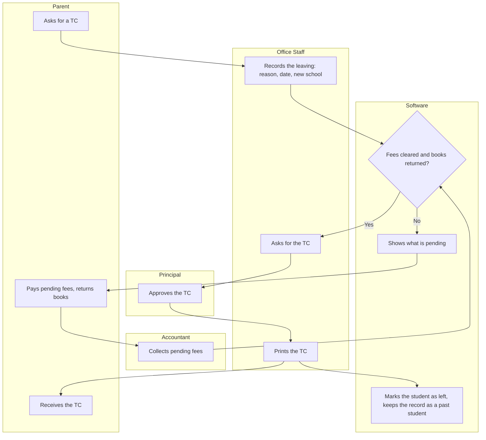

---

## 13. Expense entry

| | |
|---|---|
| **When it starts** | The school pays a bill or buys something. |
| **Who is involved** | Accountant, Principal, Software. |
| **Modules used** | Finance Management (Expenses, Day Book, Cash & Bank, Budget), Dashboard. |

### Steps

1. The accountant opens Finance Management, Expenses (or Record Expense on the Dashboard) and enters the date, vendor, expense head, department, amount and mode, and takes a photo of the bill.
2. **Automatic:** If the same bill looks already entered, the software warns.
3. **Automatic:** An amount under the approval limit set in Settings, Forms & Approvals is approved at once. A larger amount waits in the principal's Approvals.
4. The principal approves, or rejects with a reason.
5. When the bill is paid (often at once, for cash), the accountant marks the expense **Paid**.
6. **Automatic:** The paid expense goes into the Day Book and the cash book or bank book, because that is when money leaves (decided 9 October 2026). Where budgets are used, the budget used goes up (it is worked out from paid and approved expenses, not stored). The Dashboard expense numbers and Finance Reports update.
7. **Automatic:** Where budgets are used, the software alerts when a head goes over its budget.

### What could go wrong

| What could go wrong | How the software prevents it | How it explains it | How people recover |
|---|---|---|---|
| The same bill is entered twice | Duplicate warning | "A bill from this vendor for ₹4,500 on 2 March is already entered." | Open the existing one. |
| A large expense is recorded without approval | Amounts above the limit wait in Approvals before they count | The expense shows "waiting for approval". | The principal decides. |
| An expense head goes over its budget *(where budgets are used)* | Alert at the limit | "Stationery has used 110% of its budget." | The principal decides whether to go ahead. |
| A wrong amount is found later | | | Cancel the expense with a reason. The Day Book gets a reversing entry. Nothing is deleted. |
| Pending expenses are forgotten | Pending expenses are listed, and their count shows on the Dashboard | "2 expenses waiting." | Decide them in Approvals. |

### Records created or changed

- **Created:** Expense, Approval (above the limit), Day Book Entry, Notification.
- **Changed:** Expense (Draft, Waiting for approval, Approved, Paid, Cancelled), Audit Log Entry. The budget used is worked out, not stored.

### Diagram

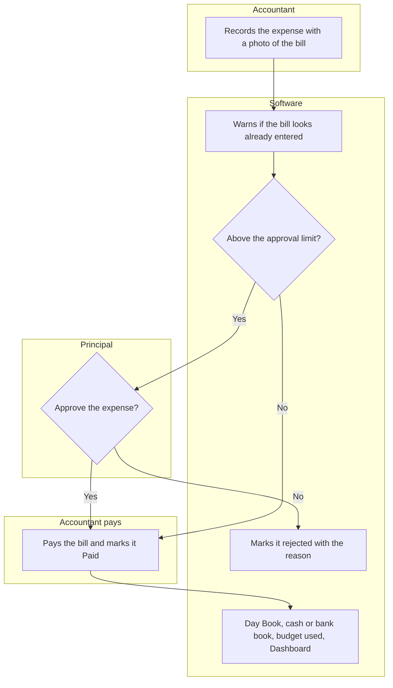

---

## 14. Transport morning trip *(optional module)*

| | |
|---|---|
| **When it starts** | Every school morning, at the start time of each route's morning trip. |
| **Who is involved** | Driver, Transport In-charge, Parent, Software. |
| **Modules used** | Transport Management, Communication, Dashboard. |

> **Decided:** Transport, with live bus tracking, is not in the first version a school can buy. Transport is the first module built after the rest.

### Steps

1. The driver opens the driver app and starts the morning trip for the route.
2. **Automatic:** The bus appears on Live Tracking with its next stop and arrival time. The location updates about every 30 seconds.
3. **Automatic:** Where switched on in Transport Settings, parents at the coming stops get a "bus arriving" message.
4. At each stop, the driver marks the stop reached and the students who boarded.
5. **Automatic:** Parents get the pickup message. The trip shows the stops reached and the students boarded.
6. **Automatic:** The transport in-charge gets an alert if the bus goes too fast, leaves the route, or goes offline.
7. The driver ends the trip at school. **Automatic:** The trip is kept in the trip history and the Dashboard bus numbers update.
8. The transport in-charge watches Live Tracking and handles alerts. In an emergency, the in-charge sends an emergency message to all parents of the route.

### What could go wrong

| What could go wrong | How the software prevents it | How it explains it | How people recover |
|---|---|---|---|
| The phone or GPS loses signal | The last known place is shown with its time, and old locations are marked. Where offline mode is used, marks are sent later. | "Last update 6 minutes ago." | The in-charge calls the driver, whose phone is on the trip card. |
| Wrong GPS points | Points that are out of order or impossible are thrown away | | Nothing to do. |
| The bus breaks down | The driver reports the breakdown from the driver app | The in-charge gets an alert. | The in-charge sends an emergency message to parents of the route. |
| The bus goes too fast or off the route | Alerts set in Transport Settings | "Bus 3 is over the speed limit on Route 2." | The in-charge calls the driver. |
| A driver's licence or the bus papers expire | Reminders before the expiry date | "Driver licence expires in 15 days." | Renew it in time and update Vehicles & Drivers. |

### Records created or changed

- **Created:** Trip, Message, Notification.
- **Read:** Route, Stop, Vehicle, Driver, Transport Assignment.
- **Changed:** Trip (stops reached, students boarded, end time).

### Diagram

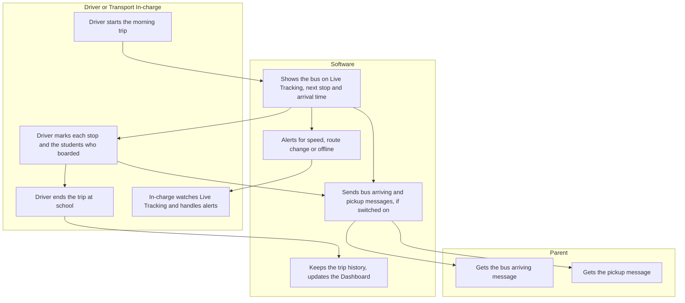

---

## 15. Switching to School OS

Added 9 October 2026 (decision D7). Every school that buys School OS arrives with records in another software, in Excel or on paper. This workflow brings them in, on any day of the year, so the school can start the next morning without retyping.

| | |
|---|---|
| **When it starts** | A school's first School Admin signs in for the first time (the Super Admin console has created the school). It can start on any day of the year, not only in April. |
| **Who is involved** | School Admin, Accountant, Office Staff, Principal, Parent, Software. DREAM TEAM's onboarding person can help through Support Access (`07-super-admin.md`). |
| **Modules used** | Settings (School Profile, Data Backup & Security importer), Academic Management, Staff & HR Management, Student Management, Fee Management, Finance Management, Admission Management, Communication (Parent Link), Dashboard (Setup checklist). |

### Steps

1. The School Admin follows the Setup checklist on the Dashboard: school profile and logo, board, the current academic year with today's term, classes, sections and subjects. **Automatic:** the board fills sensible defaults (terms, grade scale, report card).
2. The School Admin downloads the import templates in Settings, Data Backup & Security. Each template has the same columns as the screen, with one example row.
3. Office Staff import **staff** (Staff & HR), then **students and parents** (Student Management) with their class, section, roll number and admission number. Old admission numbers are kept as they are.
4. **Automatic:** For each import, the software matches the columns, shows each row's problems in plain words ("Row 14: class '5th B' does not exist. Did you mean 5 B?"), and imports only the good rows. Bad rows come back in a file to fix and re-import.
5. The Accountant sets this year's fee structures (Fee Management), then imports **old dues**: for each student, the amount still unpaid from before. **Automatic:** each amount becomes an opening balance row on the Student Fee Ledger, marked "brought in".
6. If the school starts in the middle of the year, the Accountant also imports **this year's payments already made** in the old software (receipt number, date, amount, mode). **Automatic:** each becomes a read-only Payment and Receipt marked "brought in", which reduces the dues but never goes into the new Day Book, so money is never counted twice.
7. The Accountant enters the **opening balance** of the cash book and each bank account on the go-live date, and the financial year (default April to March) (Finance Management).
8. Optional imports: open **enquiries** (Admission Management), **items and assets** (Inventory Management, when switched on), **library books** (Library Management, when switched on), **past expenses** of this financial year for reports.
9. The Principal checks the go-live summary: number of students per class, staff, total old dues, fees collected this year, cash and bank balances. Each number opens the list behind it. The Principal confirms "Go live".
10. **Automatic:** On go-live, the Setup checklist is marked done, automations start (absence messages, fee reminders), and each guardian is sent a **Parent Link** with the consent request (DPDP Act 2023), in the school's chosen language. Imports can still be undone as a whole until the first real fee payment is taken (inferred).
11. Each parent opens their Parent Link, checks their child's details and dues, and gives consent with a one-time code.

### What could go wrong

| What could go wrong | How the software prevents it | How it explains it | How people recover |
|---|---|---|---|
| A class or section in the file does not exist | Checks every row before importing | "Row 14: class '5th B' does not exist. Did you mean 5 B?" | Fix the file or pick the match, and import the bad rows again. |
| The same student is imported twice | Duplicate check on admission number, and on name with date of birth | "Ravi Kumar, 5 A, is already added." | Skip the row, or update the existing student. |
| Old dues are imported twice | One opening balance per student per import; a second import shows the difference first | "Old dues for 32 students are already brought in. Replace them?" | Replace, or undo the earlier import. |
| A brought-in payment is counted in the Day Book | Brought-in payments never post to the Day Book | The receipt shows "Brought in from old software". | Nothing to do. |
| The totals do not match the old software | The go-live summary shows totals before going live | "Total old dues: ₹14,82,300 for 318 students." | Fix the file, undo and import again before going live. |
| A parent's phone number is wrong | Parent Link and messages that fail are listed | "Parent Link could not be delivered to 12 guardians." | Correct the number in Student Management and resend. |

### Records created or changed

- **Created:** Staff, User Login, Student, Guardian, Enrolment, Student Fee Due (opening balance, "brought in"), Payment and Receipt ("brought in", only for a mid-year start), opening balances of the cash and bank books, Enquiry, Item, Asset, Book (optional), Import Batch, Parent Link, Consent Record, Audit Log Entry.
- **Read:** School, Academic Year, Class, Section, Fee Structure, Financial Year.
- **Changed:** Setup checklist progress (Dashboard).

### Diagram

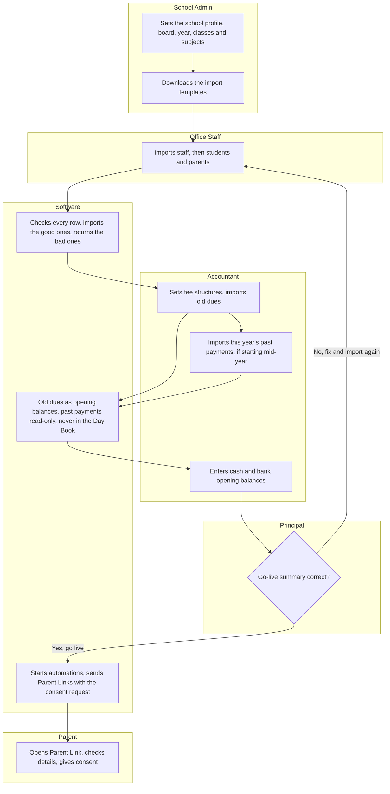
