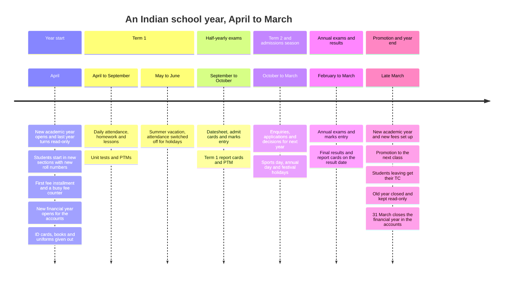
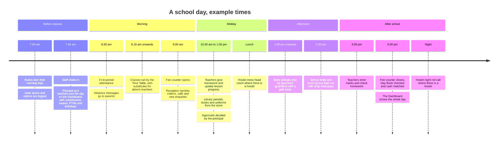

# 03. The school year and the school day

This page shows when each part of School OS is busy: across one Indian school year, and across one school day. Under each timeline, a table names the modules that are active at each point.

The dates and times are typical examples, not fixed rules. Most Indian schools run from April to March. Some state-board schools start in June. Each school sets its own year and terms in Academic Management, Academic Settings, its own exams in Examination & Results, Exam Settings, and its own school timings and periods in Academic Settings.

## The school year

### Which modules are active, through the year

| When | What happens | Modules most active |
|---|---|---|
| April, year start | The new academic year opens. Students start in their new class, section and roll number. The first installment falls due and the fee counter is busy. ID cards are printed. New admissions join. A new financial year (1 April to 31 March) opens in Finance Management, kept apart from the academic year (decided 9 October 2026). New families get their Parent Link and give consent for their child's data. | Academic Management, Student Management, Fee Management, Finance Management, Admission Management, Communication (Parent Link). Where switched on: Inventory Management (books and uniforms), Transport Management (new bus stops), Hostel Management (bed allocation). |
| April to September, Term 1 | Normal school days: attendance, homework, lessons, unit tests and PTMs. | Attendance Management, Homework & Learning, Academic Management (Syllabus & Lesson Plans), Examination & Results, Events & Calendar (PTM), Communication. |
| May to June, summer vacation | Holidays on the School Calendar switch attendance off. Fees and salary go on as usual. | Events & Calendar, Fee Management, Salary Management. |
| September to October, half-yearly exams | Datesheet, admit cards, marks, Term 1 report cards, then a PTM. Parents see the datesheet, and the report cards once published, on Parent Link. | Examination & Results, Events & Calendar, Communication (Parent Link). |
| October to March, Term 2 | Normal school days, plus sports day, annual day and festival holidays. | Attendance Management, Homework & Learning, Events & Calendar, Communication. |
| October to March, admissions season | Families enquire and apply for next year. Follow-ups, tests, interviews and decisions. Admission tests show on the School Calendar. | Front Office, Admission Management (including its admission reports), Communication, Events & Calendar. |
| February to March, annual exams | Annual exams, marks entry, final results across all exams, report cards on the result date, also shown on Parent Link. | Examination & Results, Communication (Parent Link), Reports & Analytics (Early Warnings). |
| Late March, promotion and year end | The new year and its fees are set up. Whole classes are promoted. Leaving students get their TC after fee and library clearance. Unpaid dues are carried forward. The old year is closed and kept read-only. On 31 March the financial year ends too: the accounts are checked and the year is closed in Finance Management. | Academic Management, Fee Management, Finance Management, Student Management (Promotion, Leaving & Alumni, Certificates & ID Cards), Library Management *(optional)*. |

### Every month, all year

| What | When | Modules |
|---|---|---|
| Fee installments fall due, reminders go out, late fees are added after the grace period, the Defaulters list updates. Parents see what is due and pay on Parent Link. | On the due dates and reminder days set in Fee Settings | Fee Management, Communication (Parent Link) |
| Monthly salary is worked out, approved and paid. Salary slips are made. The salary reaches the Day Book when it is marked paid. PF and ESI statements are exported for the government portals. | Month end | Salary Management, Attendance Management, Finance Management |
| Expenses, other income, cash book and bank book, all by financial year. | Every working day | Finance Management |
| Reminders before staff documents, driver licences, bus papers and warranties expire, and when stock runs low. | Before each expiry date, or when stock reaches the reorder level | Staff & HR Management, Transport Management *(optional)*, Inventory Management *(optional)* |
| Monthly attendance register and reports. Students below 75% are flagged. Parents see this month's attendance on Parent Link. | Each day, totalled each month | Attendance Management, Reports & Analytics, Communication (Parent Link) |
| Scheduled reports emailed to the principal or owner. | Weekly or monthly, where switched on | Reports & Analytics *(Custom & Scheduled Reports, optional)* |

## The school day

### Which modules are active, through the day

| Time (example) | What happens | Modules active |
|---|---|---|
| 7.00 am | Buses leave on their morning trips. Parents get "bus arriving" and pickup messages. The gate opens and visitors are logged with a pass. | Transport Management *(optional)*, Communication, Front Office |
| 7.45 am | Staff check in by register, mobile, QR or device. The principal and teachers open the Dashboard: today's substitutions, PTMs, exams and birthdays. | Attendance Management (Staff Attendance), Dashboard, Academic Management (Substitutions) |
| 8.00 am | Class teachers take attendance in two taps. Parents of absent students get one message. Students on approved leave, recorded by the class teacher or the office, show as leave. | Attendance Management, Communication |
| 8.15 am onwards | Periods run by the published Time Table. Substitutes cover absent teachers. | Academic Management |
| 9.00 am | The fee counter opens: each payment makes its receipt, Day Book entry and parent message by itself. Reception handles visitors, calls, appointments and walk-in enquiries, which go straight to Admissions. | Fee Management, Finance Management, Communication, Front Office, Admission Management |
| 10.00 am to 1.00 pm | Teachers give homework from their phones and mark lesson progress. Books are issued and returned. The store gives out stock, books and uniforms. The principal decides leave, discounts and expenses in Approvals. | Homework & Learning, Academic Management (Syllabus & Lesson Plans), Library Management *(optional)*, Inventory Management *(optional)*, top bar Approvals |
| Lunch | Mess head count for boarders. | Hostel Management *(optional)* |
| 1.00 pm onwards | A parent collects a child early. The Pickup gate pass is given only to a guardian on the approved pickup list. | Front Office (Student Pickup), Student Management |
| 2.30 pm | School ends. Evening trips run, with drop messages to parents. | Transport Management *(optional)*, Communication |
| 3.00 pm | Teachers enter marks, check homework and plan lessons. Attendance for the day is locked after the cut-off time. | Examination & Results, Homework & Learning, Academic Management, Attendance Management |
| 5.00 pm | The fee counter closes. The accountant checks the Day Book and matches the cash. The Dashboard shows the day's attendance, collection, expenses, admissions and buses. | Finance Management (Day Book, Cash & Bank), Fee Management, Dashboard, Reports & Analytics |
| Night | Night roll call in the hostel. | Hostel Management *(optional)* |
