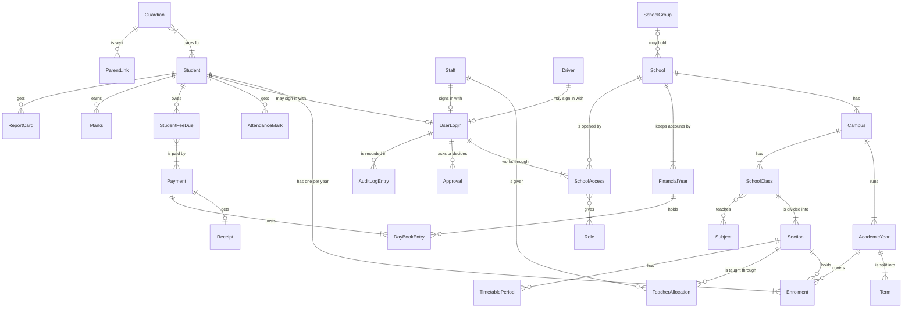
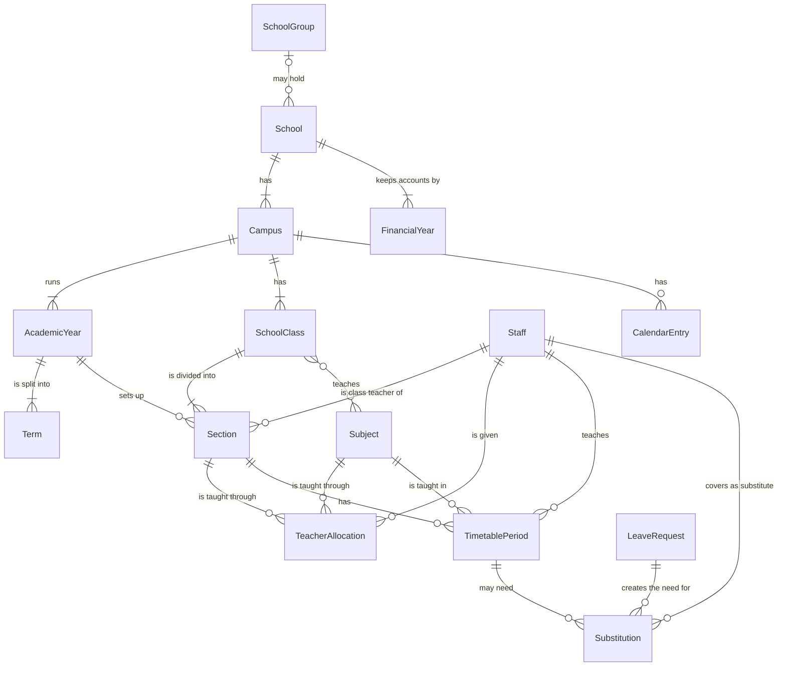
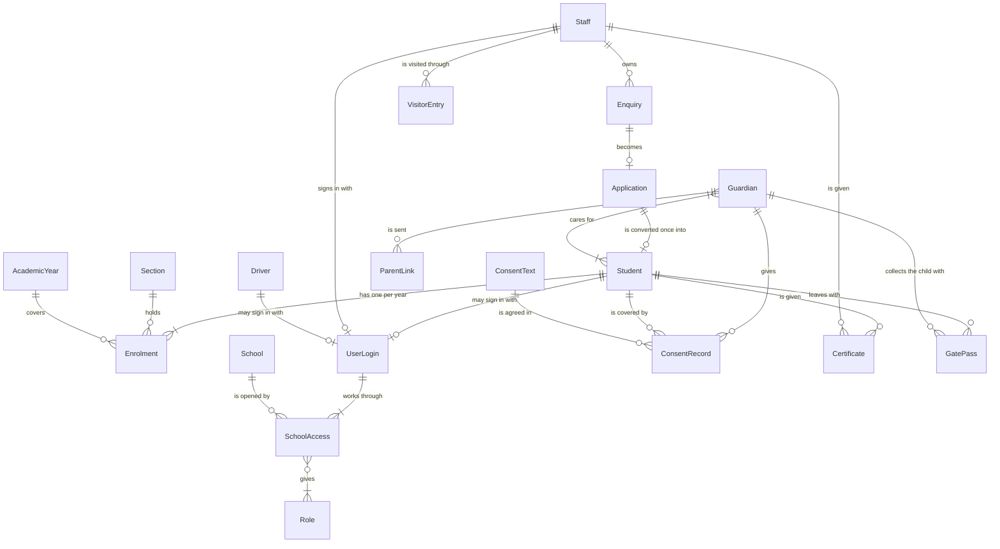
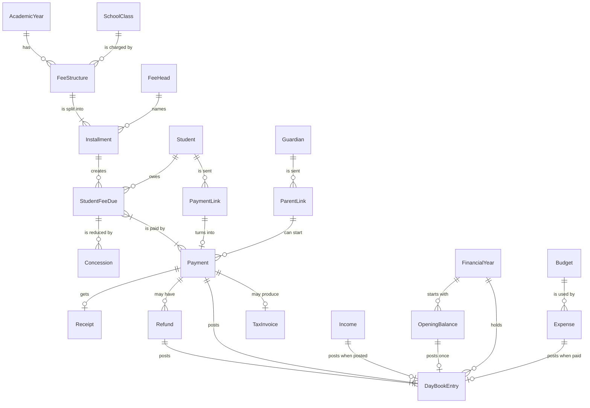
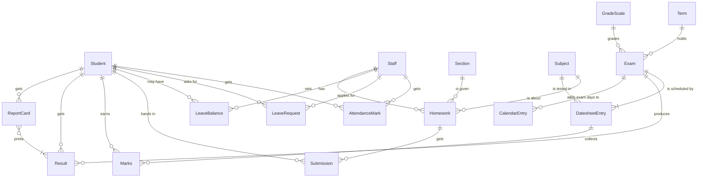
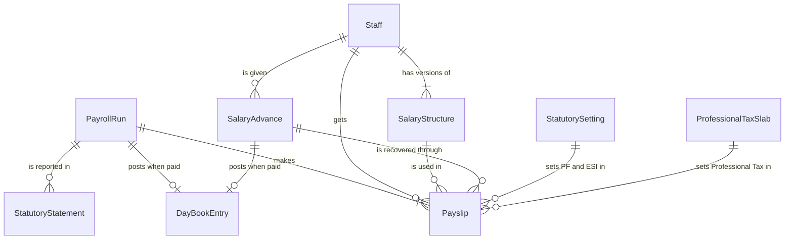
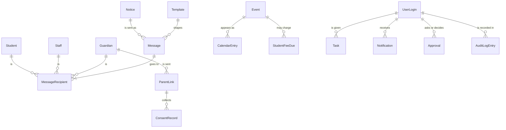
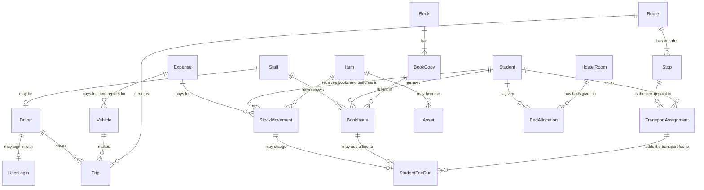

# 04. Data model: the records School OS keeps

This page lists every kind of record School OS keeps, what each one is, its key fields, and how the records link to each other. Every other file in this blueprint uses these names. When a builder or an AI coding agent creates the software, these are the things it stores.

## Words used on this page

This page is the one place where a few technical words are used. Each one is explained here.

| Word | What it means |
|---|---|
| Record | One kind of thing the software keeps, like one page type in a register. "Student" is a record. Each child is one Student record. In the database (the store where the software keeps everything) each record type is usually one table. |
| Field | One piece of information on a record, such as a student's date of birth. |
| Link | A record that points to another record. A Payment links to the Student who paid. Nothing is copied; the software follows the link. |
| One-to-many | One record links to many others. One Class has many Sections. |
| Many-to-many | Records link both ways in groups. One Guardian can have several Students, and one Student can have several Guardians. |
| Status | A field that says where a record is in its life, such as "waiting", "approved" or "cancelled". |
| Unique | No two records in the school may have the same value, such as an admission number. |
| Read-only | Can be seen but not changed. |
| Archive | Take a record out of daily lists without deleting it. It can still be found and reported on. |
| Audit log | The list of every change: who changed what, when, and the value before and after. Each line is an Audit Log Entry. |

### How to read the diagrams

The diagrams below are entity-relationship diagrams. Each box is a record. Each line is a link, with a short phrase on it. The ends of a line say how many:

| End of line | Meaning |
|---|---|
| `||` | exactly one |
| `o|` | zero or one |
| `}|` | one or more |
| `}o` | zero or more |

In the diagrams, record names are written without spaces. For example `StudentFeeDue` is the Student Fee Due record and `AcademicYear` is the Academic Year record. The Class record is drawn as `SchoolClass`, because the word "Class" on its own has a special meaning in the diagram format. The Group record is drawn as `SchoolGroup` for the same reason.

## Fields every record has

These are not repeated in the tables below.

- **School**, and **Campus** where the record belongs to one site. Each school's records are kept apart from every other school's.
- **Academic Year**, on every record that belongs to one school year (enrolments, fees, attendance, marks, salary runs and so on).
- **Financial Year**, on every Day Book Entry and other accounts record. The financial year (default April to March) is kept apart from the academic year (decided 9 October 2026).
- **Created by and when, changed by and when.**
- **Archived or not.** Records are archived, never deleted.

## The core in one picture

These are the records almost every module touches.

## Area 1: School setup and teaching

| Record | What it is | Key fields |
|---|---|---|
| Group | *Added (decided 9 October 2026).* A group or trust that runs several schools. Group screens come later; the record exists now so schools can be joined up without moving data. | Name, the schools in it. |
| School | The school using School OS. Made by Add School in the Super Admin console. | School code, status (Trial, Active, Suspended, Closed), school type, trial end date, current Subscription, name, logo, address, board, affiliation number, languages, time zone, Group (optional), GSTIN (optional, decided 9 October 2026), SMS DLT entity ID and sender header (decided 9 October 2026). |
| Campus | One site of the school. Most schools have one. A school can have several, each with its own fees and branding. | School, name, address. |
| Academic Year | One school year, such as April 2027 to March 2028. | Campus, name, start date, end date, status (upcoming, active, closed). |
| Financial Year | *Added (decided 9 October 2026).* The accounts year, kept apart from the academic year. The Day Book, cash and bank books and finance reports work by financial year. | School, name, start date, end date (default 1 April to 31 March), status (open, closed). |
| Term | A part of the year, such as Term 1 or Semester 2. | Academic year, name, start date, end date. |
| Class | A class such as Nursery, Class 5 or B.Sc 1. Any class name is allowed. | Campus, name, order, level, stream (optional), board (default the school's board; a class can have its own). |
| Section | One division of a class for one year, such as 5 A. | Class, academic year, name, seats, class teacher (Staff). |
| Subject | A subject taught in one or more classes. | Name, code, type (core, optional, elective, language), classes it is taught in, with dates from and to. |
| Teacher Allocation | Which teacher teaches which subject to which section this year. | Staff, section, subject, academic year, main or second teacher. |
| Timetable Period | One slot in the published Time Table. | Section, day, period number, start time, end time, subject, staff, room, break or not, Time Table version, date it starts. |
| Substitution | *Added in this blueprint.* A substitute teacher for one period on one date. | Date, timetable period, absent staff, substitute staff, leave request it came from, status (needed, arranged, cancelled). |
| Calendar Entry | One day or date range on the School Calendar. | Campus, academic year, type (holiday, vacation, exam day, event, PTM, admission test; decided 9 October 2026), title, start date, end date, attendance on or off that day. |

## Area 2: Students, families, staff and admissions

| Record | What it is | Key fields |
|---|---|---|
| Enquiry | The first contact from a family about admission. | Child's name, parent's name, phone, class wanted, source (walk-in, phone, WhatsApp, referral, campaign or the school's own), status (default list, which the school can change: New, Contacted, Visit scheduled, Visited, Application given, Applied, Admitted, Lost), owner (Staff), next follow-up date and time, notes, call history, reason if lost. |
| Application | The admission form for one child. | Application number (unique), enquiry it came from, child's details, parents' details, class applied for, previous school and marks, documents with a checked status for each, test and interview scores (optional), application fee payment (optional), decision (approved, rejected, waiting list), waiting list rank, remarks. |
| Student | One record for one child for life, shared by every module. | Admission number (unique in the school), name, photo, date of birth, gender, blood group, category, address, emergency contacts in order, APAAR and PEN numbers (restricted), status, joining date, leaving date and reason. Status list: lead and applicant (held in Enquiry and Application until approval), admitted, active, promoted, transferred, withdrawn, graduated, alumni, inactive. |
| Enrolment | *Added in this blueprint.* The student's class, section and roll number for one academic year. A new one is made each year. Old ones are kept. | Student, academic year, section, roll number, stream, optional subjects and second language chosen, status (studying, promoted, held back, left). |
| Guardian | A parent or guardian. Parents have no login. They get messages, payment links and one Parent Link. | Name, relationship, phone (the registered mobile for one-time codes), email, date of birth (for parents' birthday wishes, optional), occupation, address, message language, opted out of messages or not. Each link to a student holds: relationship, order as emergency contact, on the approved pickup list or not, custody or access restriction. |
| Parent Link | *Added (decided 9 October 2026).* One guardian's personal, secure link to a phone-friendly page with no password. It shows all that guardian's children: fees due with a Pay button, receipts, attendance this month, notices, the datesheet, report cards once published, and consent forms. It is read-only apart from paying and giving consent. Owned by 11 Communication. | Guardian, secure token (stored only in hashed form, never readable), status (Active, Revoked), created on, last opened, verified devices (each phone confirmed by a one-time code to the guardian's registered mobile). |
| Consent Text | *Added (decided 9 October 2026).* The wording a guardian agrees to, kept in versions. | Consent type (data processing under the DPDP Act 2023, photo consent for the gallery and social media, and the school's own), version, text, in use from date. |
| Consent Record | *Added (decided 9 October 2026).* One guardian's consent for one child, for one consent type. | Guardian, student, consent type, version agreed to, given on, how given (admission form, or Parent Link confirmed by a one-time code), withdrawn on (empty while the consent stands). |
| Staff | Every teacher and staff member. | Staff ID (unique), name, photo, phone, email, designation, department, joining date, employment type, reporting manager, status (active, on leave, suspended, resigned, retired, terminated), documents with expiry dates. |
| Department | A department of the school, such as Science, Accounts or Transport. | Name, head of department (Staff). |
| User Login | A way for one person to sign in. Staff always have one. Students have one only where the school gives students logins. A hired driver who is not on the staff can have one for the driver app (decided 9 October 2026). Parents never have one. | Username (unique), the Staff, Student or Driver record it belongs to, status (Active, Disabled, Invited), two-step login on or off, last sign-in. Its roles sit on its School Access entries. |
| School Access | *Added (decided 9 October 2026).* Lets one User Login work in a school. One login can have several, so one person can work in several schools of a group. | User login, school, campus (or all campuses), roles, scope (whole school, campus, chosen classes, own records). |
| Role | A named set of permissions, such as Principal or Accountant. See `05-roles.md` for the ten ready roles and the role templates. | Name, for each module the actions allowed (view, create, edit, archive, approve, export, print), scope (whole school, campus, chosen classes, own records), approval limits, restricted fields it may see. |
| Certificate | *Added in this blueprint.* A certificate printed for a student or a staff member. | Type (TC, bonafide, study, character, experience letter), number, person, date, status (Requested, Approved, Issued, Cancelled), approved by, printed by, QR verification code (optional). |
| Visitor Entry | One visit to the school. | Name, phone, purpose, staff member to meet, photo (optional), pass number, time in, time out, status (In, Out). |
| Gate Pass | A student leaving the school or hostel. Two kinds (decided 9 October 2026): **Pickup**, made at Front Office when a guardian collects a child early, and **Hostel Outing**, made in Hostel when a boarder goes out with a named person. | Kind (Pickup, Hostel Outing), student, reason, time out, issued by. For Pickup: the guardian who collected the child (only guardians on the approved pickup list can be chosen), verification. For Hostel Outing: going with (a named person), outing (same day) or leave (overnight), from and to date and time, approved by the warden, time returned, status (Waiting, Approved, Out, Returned, Late, Rejected). |

## Area 3: Fees and accounts

| Record | What it is | Key fields |
|---|---|---|
| Fee Head | A kind of fee, such as tuition, annual, admission, transport, exam, hostel or the school's own. Made inside Fee Structure. | Name, taxable or not, GST rate (when taxable; decided 9 October 2026). A payment for a taxable head produces a Tax Invoice and appears in the GST report. Fee amounts include GST. Bank account (optional; a link to one of the school's bank accounts, used when "Fees into different bank accounts" is on in Fee Settings; decided 9 October 2026): online payments for the head are split to that account by the gateway, and counter payments show it on the receipt and in the Day Book. Empty means the main bank account. |
| Fee Structure | The fees for one class for one year. | Class, academic year, student category (optional), version, the fee heads with amount and how often (monthly, quarterly, half-yearly, term, yearly). |
| Installment | One amount and due date inside a Fee Structure. | Fee structure, fee head, label (such as "April 2027"), amount, due date. |
| Student Fee Due | What one student owes for one installment. This is what the Defaulters list and reminders read. | Student, installment, amount, concession, late fee added, paid so far, balance, status (Not due, Due, Overdue, Paid; a row that is partly paid keeps its status and shows the amount paid so far), old dues carried in or not, opening balance brought in from old software or not (decided 9 October 2026). |
| Concession | A discount, scholarship, bulk discount or late-fee waiver. | Student fee dues it reduces, amount or percent, type (concession, bulk discount, scholarship, late-fee waiver), reason, requested by, approval, status (Waiting, Approved, Rejected, Applied). |
| Payment Link | *Added in this blueprint.* A link sent to a parent to pay online. | Student, dues it covers, amount, gateway, the message it was sent in, expiry, status (sent, paid, failed, expired), gateway reference, attempts. |
| Payment | Money received for fees, at the counter, by Payment Link or through Parent Link. | Student, the dues it pays and how much of each, total, mode (cash, UPI, card, net banking, bank transfer, cheque, gateway), reference number, time, collected by, status (Posted, Waiting for verification, Cancelled, Failed), cancel reason and who cancelled, brought in or not (decided 9 October 2026: a past payment imported from old software is marked "brought in", is read-only and is never posted to the Day Book again). |
| Receipt | The proof given for a posted payment. A receipt imported with a brought-in payment keeps its old number and is read-only. | Receipt number (unique, in the pattern set in Fee Settings), payment, date, status (valid, cancelled), brought in or not (decided 9 October 2026: imported, read-only, never posted to the Day Book). |
| Tax Invoice | *Added (decided 9 October 2026).* The GST invoice made for a payment that covers a taxable Fee Head. | Invoice number (unique), payment, date, school GSTIN, SAC code, each taxable fee head with its amount, GST rate and the GST included in it, total. |
| Opening Balance | *Added (decided 9 October 2026).* An amount brought in from old software when the school starts on School OS (workflow 15, "Switching to School OS"). A school can start on any day of the year. | Kind (cash book, bank book, or a student's old dues), financial year, date, cash or bank account or student, amount, brought in by, source file. A student's old dues become Student Fee Due rows marked as brought in. |
| Refund | Money given back from a payment. | Payment, amount, mode, reason, approval, date. |
| Promise to Pay | *Added 17 October 2026.* What a family says on a call about dues: "will pay ₹5,000 on 25 October". It is the call log note on Defaulters (Fee Call Note) with a promised date, kept as one record. Switched on school by school (Fee Settings, "Promise to pay"). | Student, call note (optional when a date is given), promised date (today or within 60 days), amount (optional; empty means everything overdue when the promise was made), overdue when made, status (Open, Kept, Broken, Replaced), paid towards it by the promised date, when it was kept or broken, recorded by. |
| Day Book Entry | One line in the Day Book. Made only by the software. | Financial year (decided 9 October 2026), date, money in or out, amount, mode, head (fee type, income head or expense head), the record it came from (payment, refund, income, expense, payroll run, salary advance, or an opening balance brought in from old software), student, staff member or vendor, the entry it reverses (for a cancellation). |
| Income | Money the school receives other than fees, including alumni donations. | Date, income head, amount, source, mode, reference, cash or bank account, status (Draft, Posted, Cancelled). |
| Expense | A bill or expense paid by the school, including transport fuel and repair bills. | Date, vendor, expense head, department, amount, mode, bill photo, status (Draft, Waiting for approval, Approved, Paid, Cancelled; decided 9 October 2026), approval. An expense turned down at approval goes back to Draft with the reason; there is no Rejected status. It reaches the Day Book only when marked Paid. |
| Budget | *Optional.* A yearly amount planned for a head or department. | Financial year, head, department, period, amount. The amount used so far is not stored: it is always worked out from paid Expenses. |

## Area 4: Attendance, homework and exams

| Record | What it is | Key fields |
|---|---|---|
| Attendance Mark | One student's or staff member's attendance for one day, or one period where the school takes attendance every period. | Student or staff, date, period (optional), status (present, absent, late, half-day, excused, leave, medical, or the school's own), method (register, mobile, QR, face, fingerprint, RFID card), marked by, time, note, locked or not. |
| Leave Request | Leave for a student or a staff member. Student leave is recorded by school staff, because parents have no login. | Student or staff, leave type, from date, to date, half-day or not, reason, document, status (Waiting, Approved, Rejected, Cancelled), recorded by, decided by, reason for the decision. |
| Leave Balance | *Added (decided 9 October 2026).* How many days of one leave type a staff member, or a student where the school switches student leave balances on, has for one year. | Staff or student, leave type, academic year, days given, adjustments with reasons, days taken (worked out from approved Leave Requests), days left. |
| Homework | Work given to a class, section or chosen students. | Section or chosen students, subject, teacher, title, instructions, attachments, date given, due date, maximum marks (100 unless the teacher changes it). |
| Submission | One student's work for one homework. | Homework, student, submitted at, files (when submitted online), status (assigned, submitted, late, graded, missing), check result (complete, incorrect), score, grade, feedback, resubmission allowed or not. |
| Exam | One exam, such as Unit Test 1 or Half Yearly. Made by creating a Datesheet. | Name, exam type, academic year, term, classes, pattern (Percentage, Grading, CGPA), grade scale, status (Draft, Published, Ongoing, Completed, Results published). |
| Datesheet Entry | One subject's paper in one exam for one class. | Exam, class, subject, date, start time, duration (end time is shown), room, invigilator, maximum marks, mark categories (theory, practical, internal and so on). |
| Marks | One student's marks in one paper. | Datesheet entry, student, marks for each mark category, grade (for grade-only subjects), absent or not, entered by, status (Not started, In progress, Submitted, Locked; kept for each paper, as in Examination & Results), change history. |
| Grade Scale | The bands that turn marks into grades. Ready-made for CBSE, ICSE and state boards, or the school's own. | Name, bands (from percent, to percent, grade, points, remark), pass rule. |
| Result | *Added in this blueprint.* One student's worked-out result for one exam, or the final result across exams. | Exam (or "final"), student, total, percentage, grade, rank (if the school uses ranks), pass or not, publish date, status (Draft, Published). |
| Report Card | The printed report for one student for a term or the year. Shown on Parent Link once published. | Student, term or year, design, marks and grades, attendance, co-scholastic grades, teacher remarks, principal remarks, date made, status (Not ready, Ready, Printed, Sent). |

## Area 5: Staff pay

| Record | What it is | Key fields |
|---|---|---|
| Statutory Setting | *Added (decided 9 October 2026).* The school's PF, ESI and Professional Tax rules, kept in Salary Settings. The school can change rates and ceilings. | PF on or off, PF rates (default 12% employee and 12% employer on basic pay up to the wage ceiling), PF wage ceiling (default ₹15,000 a month); ESI on or off, ESI rates (default 0.75% employee and 3.25% employer), ESI wage limit (default ₹21,000 a month); Professional Tax on or off, and the state; valid from. |
| Professional Tax Slab | *Added (decided 9 October 2026).* One band of a state's Professional Tax table. Optional. | State, salary from, salary to, monthly amount (and a different amount for a chosen month where the state's table says so), valid from. |
| Statutory Statement | *Added (decided 9 October 2026).* The monthly PF or ESI statement exported for the government portals. | Payroll run, month, campus, kind (PF or ESI), staff lines with wages and employee and employer shares, totals, file made, made by, date. |
| Salary Structure | One staff member's earnings and deductions. A change makes a new version; old versions are kept. | Staff, earnings and deductions (name, amount or rule), PF and ESI apply or not, monthly TDS amount (typed in, not calculated, in the first version), valid from, version. |
| Payroll Run | The salary for one month for all staff of one campus. Only one per month per campus (decided 9 October 2026). | Month, campus, status (Open, Calculated, Waiting for approval, Approved, Paid, Locked), totals, approved by, paid on, locked on. It reaches the Day Book only when marked Paid. Locked comes after Paid: the Accountant locks it, or it locks by itself when the next month's run is approved. |
| Payslip | One staff member's salary slip for one month. | Payroll run, staff, salary structure version used, days worked, leave, overtime, gross pay, deduction lines (PF employee share, ESI employee share, Professional Tax, TDS, and the school's own), employer PF and ESI shares (shown, not deducted), advance or loan recovered, substitution pay, adjustments with reasons, net pay, status (Made, Sent, Downloaded). |
| Salary Advance | An advance or loan given to a staff member and recovered from later salaries. | Staff, type (advance or loan), amount, date given, monthly recovery, start recovery from, reason, recovered so far, balance, status (Active, Closed). It reaches the Day Book when paid out (decided 9 October 2026). |

## Area 6: Messages, calendar, approvals and the audit log

| Record | What it is | Key fields |
|---|---|---|
| Message | One send by WhatsApp, SMS, email or app notification, to one person or to many (decided 9 October 2026). | Channel, template, text, audience chosen, number of recipients, cost in credits, sent by a person or by an automatic rule, what caused it (such as "absent today"), time. |
| Message Recipient | *Added (decided 9 October 2026).* One person who gets one Message, with their own delivery status. | Message, recipient (guardian, student or staff), phone or email used, status (Queued, Sent, Delivered, Read, Failed), reason if failed, time of each change. |
| Notice | A circular or notice for chosen classes, roles or campuses. Shown on Parent Link. | Title, text, attachments, audience, priority, publish time, expiry date, approval, status (Draft, Waiting for approval, Scheduled, Published, Expired, Archived), read count. |
| Template | A ready message format with blanks. | Name, category, channel, language, text with blanks (such as student name or due amount), version, WhatsApp approval status (Approved, Pending, Rejected), DLT template ID (for SMS; decided 9 October 2026: an SMS can be sent only from a template that has one). |
| Event | A school event, such as Annual Day or a PTM. | Type, title, date, venue, audience, registration needed or not, fee (optional), reminders, status (Planned, Open for registration, Done, Cancelled). |
| Media Tag | *Added.* A student shown in a gallery photo or video. A photo is shown or shared only if every tagged student's guardian has given photo consent (Consent Record). | Photo or video, student, tagged by, date. |
| Activity Credit Entry | *Added. Optional.* Points a student earns for an activity. The total shows on the Student Profile. | Student, activity or event, points, reason, given by, date. |
| Task | A piece of work given to a staff member. | Title, given to, given by, due date, reminder, status. |
| Approval | One request waiting for a yes or no. | Type (leave, discount, refund, expense, admission, certificate, correction, salary, purchase, notice and others), the record it is about, asked by, current approver, step, status (waiting, approved, rejected, withdrawn, escalated), reason, decided at. |
| Notification | An alert inside School OS for one person with a login. It opens the right screen. | User login, text, screen it opens, read or not, time. |
| Audit Log Entry | One change to any record. It can never be changed or deleted. | Who, which record, what action, value before, value after, when, from which device. |

## Area 7: Optional services (Transport, Library, Inventory, Hostel)

These records exist only for schools that switch the module on.

| Record | What it is | Key fields |
|---|---|---|
| Route | A bus route. | Name, stops in order, morning and evening times, vehicle, driver. |
| Stop | A pickup point on a route. | Route, name, order, pickup time, drop time, transport fee (one-way and two-way). |
| Vehicle | A school bus or van, owned or hired. | Number, type, seats, status, insurance, fitness and pollution certificate expiry dates, vendor if hired. |
| Driver | A driver or conductor. Can be on the school's staff or hired; either way the driver can have a User Login for the Android driver app (decided 9 October 2026). | Name, phone, staff record if on the school's staff, vendor if hired, licence number, licence expiry date, driver or conductor, user login (optional). |
| Trip | One morning or evening run of a route on one date. | Route, vehicle, driver, date, morning pickup or evening drop, start time, end time, stops reached, students boarded, status (Scheduled, Started, Completed, Cancelled). |
| Transport Assignment | Which student uses which route and stop. | Student, route, stop, one-way or two-way, from date, to date, bus pass number. |
| Book | One title in the library. | Title, author, publisher, ISBN, category, subject. |
| Book Copy | One physical copy of a book. | Book, accession number, barcode, status (Available, Issued, Reserved, Lost, Damaged, Withdrawn). |
| Book Issue | One book copy lent to one person. | Book copy, student or staff, issued on, due on, returned on, renewals, fine (reason late, lost or damaged; status Due, Paid, Waived). A student's fine can be added to their fees as a Student Fee Due row. |
| Item | One kind of stock, such as chalk, notebooks or uniforms. | Item code (SKU, unique), name, unit, category, reorder level, store location. Stock in hand is worked out from Stock Movements. |
| Book Set | *Added.* A set of Items sold or issued together, such as a class's book set. | Name, class (optional), items with quantities, price. Issuing a set makes one Stock Movement per item. |
| Stock Movement | Stock coming in, going out, moving between stores, or written off. | Item, type (in, out, transfer, damaged, lost, expired), quantity, date, from and to (store, department, class, staff or student), purchase bill, charge to the student's fees or not. |
| Asset | Furniture, computers and equipment the school owns. | Asset tag (unique), name, category, location, given to, purchase date, warranty end date, status (In use, In repair, Disposed), repair log. |
| Hostel Room | One room in a hostel. | Hostel (boys or girls), floor, room number, number of beds, warden. |
| Bed Allocation | One student given one bed. | Student, hostel room, bed number, check-in date, check-out date, status (Checked in, On outing, Checked out). |

## Key rules

These rules hold everywhere. A builder should write a check for each one.

**One record, shared by all**

1. One Student record is shared by every module. It is made once, when an admission is approved or a student is added or imported. No module keeps its own copy.
2. A Guardian can have several Students, and a Student can have several Guardians. A brother and sister share the same Guardian record.
3. The same is true for Staff: one Staff record for every module.
4. A student's class for each year is kept in its own Enrolment. Promotion adds a new Enrolment. It never overwrites last year's.
5. An Application turns into a Student only once.

**Money**

6. Payments and receipts are never edited or deleted. A wrong one is cancelled with a reason, or refunded with a reason. Both stay on record. *Decided: staff can never delete a fee payment.*
7. A Receipt is made only for a Posted Payment. Receipt numbers are unique and never reused.
8. An online Payment is posted only after the payment gateway confirms it. The same confirmation can never post twice. Failed attempts are flagged.
9. A Payment can never be more than what is due, unless the school allows advance payment in Fee Settings. A Refund can never be more than what was paid.
10. Day Book Entries are made only by the software, from Payments, Refunds, Income, Expenses, Payroll Runs, Salary Advances and opening balances brought in from old software. Nobody types them. An Expense, a Payroll Run and a Salary Advance post only when marked Paid, because that is when money leaves (decided 9 October 2026). Cancelling a payment adds a reversing entry; it does not remove the first one.
11. The Installments of a fee head add up to its total in the Fee Structure.
12. Discounts, refunds and expenses above the limit set in Settings, Forms & Approvals need an Approval before they count.
13. A Payroll Run cannot be changed once Approved, and is Locked after it is Paid (by the Accountant, or by itself when the next month's run is approved). A mistake is put right by a reversal or an adjustment with a reason, never by changing the run. There is only one Payroll Run per month per campus.

**Marks and attendance**

14. Marks are between 0 and the paper's maximum. A change after marks are locked needs a reason and an Approval, and the old value is kept.
15. A Grade Scale has no gaps and no overlaps. Changing it never changes results already published.
16. Results in draft cannot be published.
17. Attendance locks after the cut-off time set in Attendance Settings. A later change needs a correction request and an Approval. The original mark stays in the audit log.
18. A holiday on the School Calendar switches attendance off for that day. Reports leave the day out.

**Years and history**

19. Each campus has only one active Academic Year. Past academic years are kept read-only. Only an authorised correction can change them, and it is logged.
20. Fee Structures and Salary Structures keep their old versions. A change applies from a date; it never rewrites the past.
21. Records are archived, never deleted. A student who leaves becomes a past student; the record stays.

**Safety and checks**

22. Every change to money, marks or attendance is written to the audit log, with the value before and after. So is every approval decision and every change to a student's or staff member's details.
23. Audit Log Entries can never be changed or deleted.
24. Permissions are checked by the software for every action, not only hidden on screen. A person sees only the records their Role and scope allow, in lists, exports, search and AI answers.
25. Admission numbers, staff IDs, application numbers, receipt numbers, usernames and asset tags are unique in the school.
26. No double booking: a teacher, room or invigilator cannot be in two places in the same period. A Substitution cannot give a teacher two classes at once.
27. A student has at most one active Bed Allocation. A Book Copy can be issued to only one person at a time, and only within the borrowing limit.
28. A TC can be printed only when the student's fee dues are cleared and, where Library is on, all books are returned.
29. A Pickup Gate Pass can name only a guardian on the student's approved pickup list. A Hostel Outing Gate Pass names the person the student goes with and must be approved by the warden before the student is marked out.
30. AI never invents facts. It uses only the school's real records that the person may see, labels what it shows as a suggestion, and changes nothing until a person says yes.

**Added on 9 October 2026**

31. A Parent Link shows only that guardian's own children, and only what the school has chosen to show. It is read-only apart from paying and giving consent. Its secure token is stored only in hashed form. A new phone must be confirmed by a one-time code to the guardian's registered mobile. A revoked link stops working at once. A child whose link to the guardian has a custody or access restriction is not shown, and cannot be paid, consented or booked for, on that guardian's Parent Link; that guardian gets none of that child's messages.
32. A User Login belongs to exactly one Staff, Student or Driver record. It can open only the schools and campuses named in its School Access entries, with the roles and scope set there. Each school's records stay apart from every other school's, even inside one Group.
33. A Consent Record keeps the Consent Text version agreed to. A new version of a text never changes past records. A withdrawn consent stays on record with its withdrawal date and is no longer used from that date. Photos of a student are used in the gallery or on social media only while photo consent stands.
34. An SMS can be sent only from a Template that has a DLT template ID.
35. Every Day Book Entry belongs to one Financial Year. Finance reports, the cash book and the bank book work by financial year, not by academic year. A closed financial year is read-only.
36. A Payment or Receipt brought in from old software carries the "Brought in" flag, is read-only and is never posted to the Day Book. Old dues come in as Opening Balances on Student Fee Due rows. Cash and bank Opening Balances post to the Day Book once, at go-live.
37. A Payment for a taxable Fee Head produces a tax invoice using the Fee Head's GST rate and the school's GSTIN.
38. A Budget's amount used is never stored or typed. It is always worked out from paid Expenses.
39. When fees go into different bank accounts, every part of a Payment belongs to the bank account linked to its Fee Head at the time of payment. Changing a Fee Head's bank account later never moves past payments (decided 9 October 2026).

**Added on 17 October 2026**

40. A student has at most one Open Promise to Pay; a new promise marks the earlier one Replaced. While it is Open and its date has not passed, automatic fee reminders to that family pause (reminders sent by hand still go). It is Kept when posted payments made after the call and dated on or before the promised date cover it (brought-in receipts never count). It is Broken when the date passes without that: the family goes to the top of Defaulters, the person who recorded it is told, and automatic reminders resume. A Promise to Pay is never deleted; each change of status is in the audit log. The fee forecasts count an Open promise on its promised date, for what is left to pay on it, and leave that family's overdue rows out of the usual share so nothing counts twice.

## Outside any school: the Super Admin console

DREAM TEAM SERVICES' own console (`07-super-admin.md`) keeps a few records that belong to no school: **Super Admin User, School Invite, School Status Change, Support Access Request, School Note, Plan, Subscription, Platform Invoice** and **Console Activity Entry**. Their fields are in `07-super-admin.md` §10. They never hold student, fee or salary details. A Support Access Request lets a DREAM TEAM person look inside one school only after that school allows it, for a set time.

## Records added in this blueprint

The shared list of record names had 65 records. This blueprint adds five, because the workflows need them:

| Added record | Why it is needed |
|---|---|
| Enrolment | Keeps each year's class, section and roll number, so promotion never overwrites last year. |
| Substitution | Holds the substitute teacher for a period on a date, linked to the leave that caused it. |
| Result | Holds the worked-out total, percentage, grade and rank, and the publish date, apart from the raw marks. |
| Certificate | Keeps every TC, bonafide, study, character certificate and experience letter with its number and approval. |
| Payment Link | Holds an online payment from the moment the link is sent until the gateway confirms or fails it. |

Module specs list Substitution, Result, Certificate and Payment Link under "Other records (inferred)". They are defined on this page, as above.

The decisions of 9 October 2026 add these records:

| Added record | Why it is needed |
|---|---|
| Group | Lets several schools of one trust be joined up later (D10). |
| School Access | Lets one User Login work in several schools or campuses, each with its own roles and scope (D10). |
| Financial Year | Keeps the accounts year (April to March) apart from the academic year (D8). |
| Parent Link | Holds each guardian's personal secure link and the phones it has been confirmed on (D4). |
| Consent Text | Keeps each version of the consent wording (D8, DPDP Act 2023). |
| Consent Record | Keeps which guardian agreed to which version for which child, how, and when it was withdrawn (D8). |
| Message Recipient | Gives each person in a Message their own delivery status (C3). |
| Leave Balance | Keeps leave days given, taken and left per person per leave type (C5). |
| Statutory Setting | Holds PF, ESI and Professional Tax rules, rates and ceilings (D9). |
| Professional Tax Slab | Holds each state's Professional Tax bands (D9). |
| Statutory Statement | Holds each month's PF and ESI export for the government portals (D9). |
| Tax Invoice | Holds the GST invoice for payments on taxable fee heads (D8). |
| Opening Balance | Holds cash, bank and old student dues brought in at go-live (D7). |
| Salary Advance | Holds an advance or loan, its recovery, and its Day Book posting when paid (D12). |

The gap list of 17 October 2026 adds:

| Added record | Why it is needed |
|---|---|
| Promise to Pay | Lets the accountant note the date (and amount) a family promises on a call, pause automatic reminders until then, and count promises kept and broken. Kept on the Fee Call Note, not as a copy. |

Module specs in `modules/` name more small records, marked "(inferred)". They hang off the records on this page. Confirm them with the owner before building. Where a module spec and this page use different names for the same thing, the name on this page wins:

| Name in a module spec | Name on this page |
|---|---|
| Student Class History (`modules/03-student-management.md`) | Enrolment |
| Final Result (`modules/08-examination-results.md`) | Result, with the exam set to "final" |
| Bed (`modules/15-hostel-management.md`) | The bed number on Bed Allocation. A builder may keep it as a small Bed record under Hostel Room. |
| Outing pass (`modules/15-hostel-management.md`) | Gate Pass of the kind Hostel Outing |
| Advance or Loan (`modules/10-salary-management.md`) | Salary Advance |
| Library Fine (`modules/13-library-management.md`) | The fine on Book Issue. A builder may keep it as a small Library Fine record under Book Issue. |
