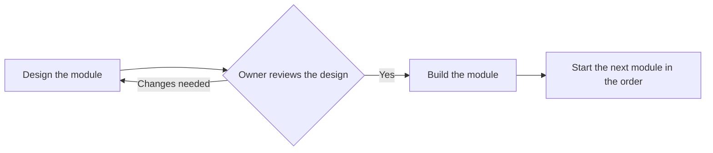
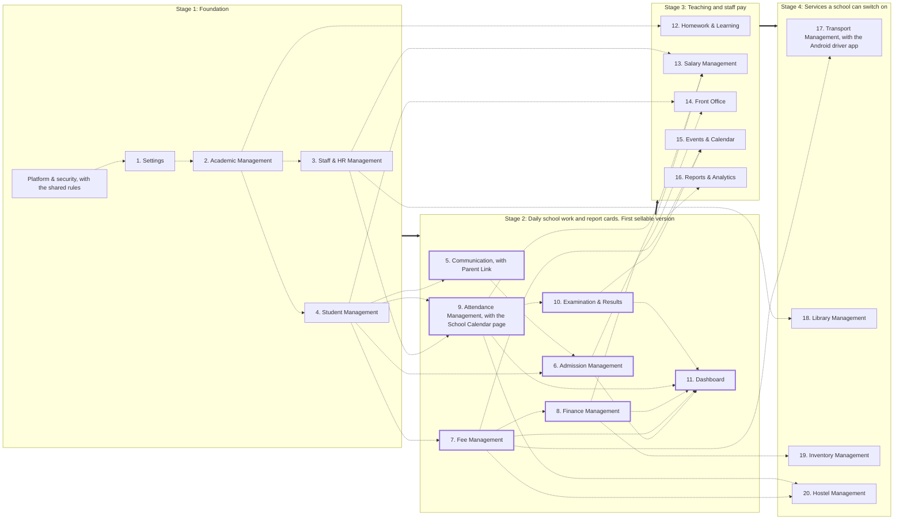

# 06. Build order

School OS is built in 4 stages, one module at a time, in the order of the plan. Each module is designed, reviewed by the owner, then built, before the next one starts. This page shows the stages, what each module needs before it, and what a school can do after each stage.

**Stage 2 is the first version a school can buy.** It includes report cards (decided 9 October 2026).

## How each module is built

The shared rules for every screen (the top bar, Approvals, Notifications, roles and permissions, and how lists, forms and confirmations behave) are described in `modules/00-global.md`. The work underneath every screen (each school's data kept apart, passwords, encryption, backups, speed and the connections to gateways and devices) is described in `08-platform-security.md`. Both are built together with Settings at the start of Stage 1, because every other module uses them.

## The four stages

Thick arrows join the stages. Dotted arrows show what a module needs before it can be built. Every module also needs the modules of Stage 1. The dotted arrow from the whole of Stage 2 to Reports & Analytics means it needs every module built so far. To keep the picture readable, only the most important needs are drawn; the full list is in the table below.

## What each module needs before it

This table follows the plan's reasons word for word where it gives them.

| # | Module | Stage | Needs before it | Why |
|---:|---|---|---|---|
| - | Platform & security (`08-platform-security.md`) and the shared rules (`modules/00-global.md`) | 1 | Nothing | Every screen sits on them: each school's data kept apart, logins, backups, the top bar and the shared patterns. |
| 1 | Settings | 1 | Platform & security | School profile, users and roles are needed by every other screen. |
| 2 | Academic Management | 1 | Settings | The academic year, classes, sections and subjects must exist before anyone is placed in them. |
| 3 | Staff & HR Management | 1 | Settings, Academic Management | Add Staff needs classes and subjects; the Time Table and class teachers need staff. |
| 4 | Student Management | 1 | Settings, Academic Management | Students and parents are the base for fees, attendance and exams. |
| 5 | Communication | 2 | Student Management, Staff & HR Management, Settings | Fee, attendance and admission messages all go out through it. Parent Link is built here and shows more as each later module arrives. |
| 6 | Admission Management | 2 | Student Management, Communication | New students come in here and become students automatically. |
| 7 | Fee Management | 2 | Student Management, Academic Management, Settings (Payment Gateways) | The most used module in an Indian school office; needs students and classes. |
| 8 | Finance Management | 2 | Fee Management | The Day Book fills from fee payments, so it follows fees. |
| 9 | Attendance Management | 2 | Student Management, Staff & HR Management | Needs students, staff and the holiday list; the School Calendar page is built here too. |
| 10 | Examination & Results | 2 | Academic Management, Student Management, Attendance Management | Needs subjects, students and attendance for the report card. In the first sellable version because a school cannot switch software if it cannot print the term's report cards (decided 9 October 2026). |
| 11 | Dashboard | 2 | Modules 1 to 10 | Shows numbers from all of the above, so it comes last in this stage. |
| 12 | Homework & Learning | 3 | Academic Management | Needs classes, subjects and teacher allocation. |
| 13 | Salary Management | 3 | Staff & HR Management, Attendance Management, Finance Management | Needs staff, staff attendance and leave, and posts into the Day Book. |
| 14 | Front Office | 3 | Admission Management, Student Management | Hands enquiries to Admissions and checks pickups against student records. |
| 15 | Events & Calendar | 3 | Examination & Results, Staff & HR Management, Fee Management | PTMs need results and teacher slots; event payments use Fee Management. |
| 16 | Reports & Analytics | 3 | Every module built so far | Brings together the reports of every module built so far. |
| 17 | Transport Management | 4 | Student Management, Fee Management | Needs students and fees for stop-wise transport fees; most asked for, so first here. Comes with a small Android driver app for reliable bus location (decided 9 October 2026). |
| 18 | Library Management | 4 | Student Management, Staff & HR Management | Needs students, staff and ID cards. |
| 19 | Inventory Management | 4 | Finance Management | Needs Finance for purchases and bills. |
| 20 | Hostel Management | 4 | Student Management, Fee Management, Attendance Management | Needs students, fees and attendance; fewest schools use it, so last. |

## What a school can do after each stage

| After | A school can | Not yet |
|---|---|---|
| **Stage 1: Foundation** | Set up the school profile, logo, board and campuses. Create users and roles. Open the academic year with its terms. Add classes, sections, subjects and the Time Table. Add staff with their logins, classes and subjects. Add or import students and parents, see each Student Profile, and print ID cards and certificates. Every school's data is kept apart and backed up from the first day. | No fees, attendance or messages yet. Not ready to sell. |
| **Stage 2: Daily school work and report cards** *(first sellable version)* | Move in from old software, including old dues and opening balances (workflow 15). Run admissions from enquiry to joining, with parent consent. Collect fees at the counter with receipts and GST invoices where needed, follow up on dues, and see the Day Book fill itself. Record expenses and other income by financial year. Take student and staff attendance, record student leave, and use the School Calendar for holidays. Run exams from Datesheet to report card. Send messages and notices to parents and staff. Parents open their Parent Link to see fees, pay online, download receipts and see attendance, notices and report cards. See today's numbers and what needs attention on the Dashboard. | No homework, salary, front office or reports catalogue yet. |
| **Stage 3: Teaching and staff pay** | Give and grade homework. Run monthly salary with PF and ESI worked out, and salary slips. Run the reception desk: visitors, gate passes and appointments. Plan events and PTMs, and keep the photo gallery. Find every report in one place, with analytics, early warnings and government reports. | No transport, library, inventory or hostel yet. |
| **Stage 4: Services a school can switch on** | Switch on buses with live tracking through the driver app, the library, stock and assets, and the hostel, only if the school needs them. Each one adds to fees, accounts and the Student Profile without changing anything else. | Everything in the plan is built. |

## The Super Admin console

The Super Admin console (`07-super-admin.md`) is DREAM TEAM SERVICES' own set of screens, separate from the School Master, built in the same code (decided 9 October 2026):

- **At the end of Stage 2:** Add School, School Admin invites, school statuses, Team and Activity Log. Stage 2 is the first version a school can buy, and nobody can sign in without them.
- **Before the first trial ends** (30 days after the first school starts): Plans & Billing.
- **Later** (`07-super-admin.md` §9): Support Tickets, Announcements, Sales Leads, the full System Health page and API keys.

## After Stage 4

**A full parent app** (login, homework, PTM booking, leave requests, bus tracking) is the first thing planned after Stage 4. It is not specified in this blueprint yet. Until then, parents use Parent Link and WhatsApp (decided 9 October 2026).

## Decisions that touch the build order

| Decision | Decided | What it changes |
|---|---|---|
| Which online payment gateway to connect first: Razorpay, PhonePe or Easebuzz? | **Razorpay.** It is already active in the demo school and most Indian schools know it. The others follow one by one. Cash and UPI at the counter work from the first day. | The first gateway built in Settings, Payment Gateways and used by Fee Management in Stage 2. |
| Can staff delete a fee payment? | **No.** A wrong payment is cancelled with a reason and stays on record, so receipts, balances and the Day Book always match. | How Fee Management and Finance Management handle mistakes in Stage 2. |
| Should Transport, with live bus tracking, move into the first sellable version? | **No.** The first version reaches schools sooner without it. Transport is the first module built after the rest, and not every school runs buses. | Transport Management stays in Stage 4. |
| Should report cards be in the first sellable version? | **Yes.** Examination & Results moves from Stage 3 to Stage 2. | Examination & Results is now 10th and the Dashboard 11th. |
| Where do backups, data separation and security live? | **In School OS itself, in `08-platform-security.md`,** not in the Super Admin console. | Built in Stage 1, before Settings. |
| Do parents get anything to open? | **Parent Link in Stage 2;** a full parent app after Stage 4. | Communication builds Parent Link. |
| Is the Super Admin console part of the plan? | **Yes** (`07-super-admin.md`). | Add School, School Admin invites, school statuses, Team and Activity Log at the end of Stage 2; Plans & Billing before the first trial ends. |
| Does a bus driver need a proper phone app? | **Yes, a small Android driver app,** with Transport. | Built in Stage 4. |

All decisions are listed in `README.md`, "Decisions made".

## Not built at all

A Safety & Health module and a School Website are not part of School OS. A full parent app comes after Stage 4 and is not part of this blueprint. The Super Admin console (`07-super-admin.md`) is DREAM TEAM's own screens, built at the end of Stage 2. The "Share the App" link is removed from the menu.
