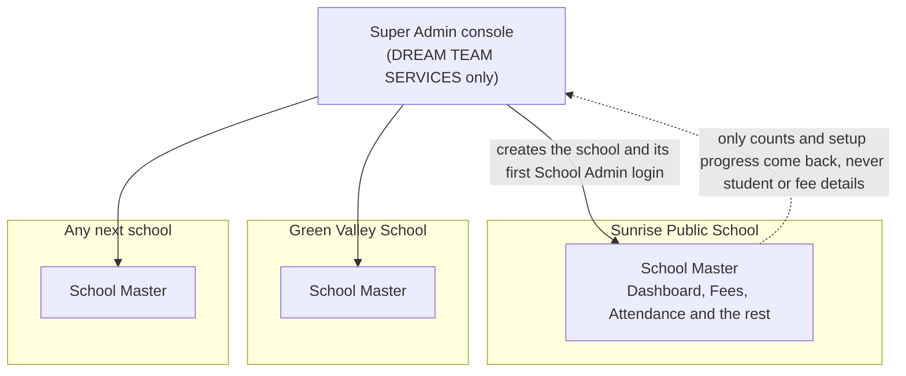
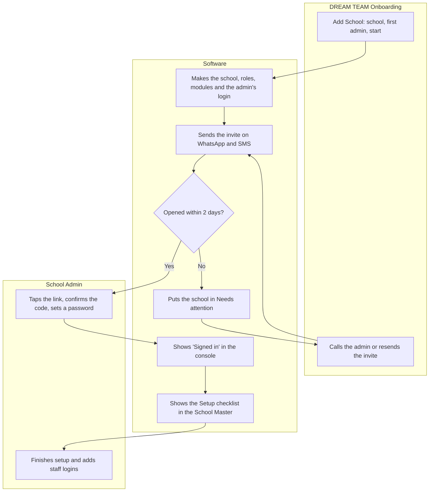
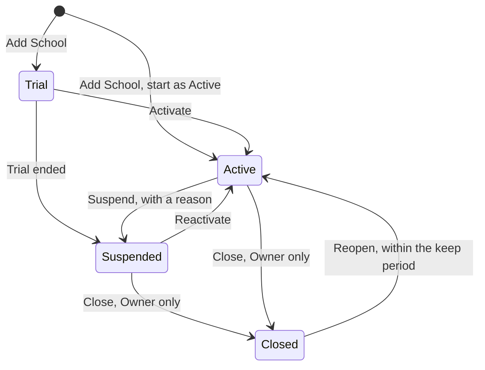

# 07. Super Admin: DREAM TEAM's own console

**Status: decided 9 October 2026.** The owner's five questions are answered in section 12. Plans and billing follow the pricing decided the same day (`school-os/pricing/pricing.md`: Essential ₹120 per student a year). The work underneath every screen (each school's data kept apart, passwords, backups, encryption) is part of School OS itself and lives in `08-platform-security.md`; this console only shows and uses it.

## 1. What this is

School OS is sold to many schools. Each school has its own School Master, where the school's own people work. Above all of them sits one more screen that only DREAM TEAM SERVICES uses: the **Super Admin console**.

It answers four questions for DREAM TEAM:

1. Which schools use School OS, and what state is each one in?
2. How do we add a new school and give its first admin a login?
3. Which schools need our help today?
4. Who in our own team did what?

The name **Super Admin** is kept because it is the word the old software uses, the requirement documents use, and school software companies use.

**The line between the two.** The Super Admin console creates a school and its first School Admin. From then on, the school runs itself: its School Admin creates every other login (Principal, Accountant, Teachers and so on) in Settings, Users & Permissions (`modules/20-settings.md`), exactly as today. DREAM TEAM does not create teacher or accountant logins, and does not see students, marks, fees or salaries.

## 2. Who uses it

These are people in DREAM TEAM SERVICES, not school staff. The owner can change these roles.

| Role | What they do | What they can do here |
|---|---|---|
| **Owner** | Runs DREAM TEAM SERVICES. | Everything, including the Team page, closing a school, discounts and marking a bank transfer or cheque as paid. |
| **Onboarding** | Signs up new schools and gets them started. | Add schools, create and resend School Admin invites, see setup progress, start trials. Cannot close a school. |
| **Support** | Helps schools that are stuck. | See schools and their admins, resend invites, reset an admin's login, ask a school for support access. Cannot add or close schools. |

Every Super Admin user signs in with a password and a one-time code on their phone, every time on a new device (two-step login is always on here).

## 3. Pages

The menu has six items. Version 1 needs all six before the first school is sold.

| Menu item | What it is for |
|---|---|
| Dashboard | What needs attention across all schools today. |
| Schools | Every school, and the button to add a new one. Each school has its own page. |
| Support Access | Requests to look inside a school's School Master to help, and their history. |
| Plans & Billing | The price list, each school's subscription, invoices and renewals. |
| Team | DREAM TEAM's own users and their roles. |
| Activity Log | Every action anyone in the console took. |

### 3.1 Dashboard

**Purpose:** "Which schools need us today?" Not a page of statistics.

**What the person sees**

- **Needs attention** first, one line per item, each with the button that fixes it:

| Item | Example line | Button |
|---|---|---|
| School Admin never signed in | "Sunrise Public School: admin invite sent 3 days ago, not opened." | **Resend invite** |
| Invite expired | "Green Valley School: invite link expired yesterday." | **Send new invite** |
| Setup stuck | "St. Mary's: setup 3 of 10 steps, no change for 7 days." | **Call the admin** (shows their phone) |
| Trial ending | "Green Valley School: trial ends in 4 days." | **Open school** |
| Renewal due or in grace | "Little Stars Pre-school: renewal unpaid, 6 days of grace left." | **Resend invoice** |
| More students than paid for | "St. Xavier's: 468 active students, 400 paid for." | **Make top-up invoice** |
| Support access waiting | "Request to Sunrise Public School waiting for their answer." | **Open request** |
| Something not working | "WhatsApp messages not going out for 12 minutes, 3 schools affected." | **Open System alerts** |

- **Schools at a glance:** count by status (Trial, Active, Suspended, Closed), and new schools this month. Each number opens the Schools list with that filter.
- **System alerts:** the views of what `08-platform-security.md` §11 records: errors rising, slow pages, messages not going out, failed background jobs, last backup and last restore test. Green when all is well; each problem names the schools affected.
- **Recent activity:** the last 10 lines of the Activity Log.
- One big button: **Add School**.

### 3.2 Schools

**Purpose:** find any school in seconds; add a new one.

**What the person sees**

- A list with search (name, city, phone, school code) and filters (status, board, city, setup progress, added by).
- Each row: logo, school name, city, board, status, School Admin name and whether they have signed in, setup progress ("6 of 10"), students count, date added.
- Button: **Add School** (section 4).

### 3.3 One school's page

**Purpose:** everything DREAM TEAM needs about one school, on one page.

**What the person sees**

- **Header:** logo, name, school code, city, status badge, and the buttons that fit the status (for example **Activate** on a Trial school).
- **School details:** name, address, city, state, board, school type, phone, email, number of campuses. Editable here only until the school's admin first signs in; after that the school edits its own details in Settings, School Profile, and this page shows them read-only.
- **School Admin logins** (section 5): each admin with name, phone, email, status (Invited, Active, Disabled), last sign-in.
- **Setup progress:** the same checklist the school sees on its Dashboard (`modules/01-dashboard.md`), for example "Classes added: done. Students imported: not yet."
- **Usage, counts only:** students, staff logins, last sign-in by anyone, messages sent this month, modules switched on. No names, no money amounts.
- **Status history:** every status change with date, who, and reason.
- **Notes:** short notes the team writes, such as "Principal prefers calls after 4 PM." Visible only inside DREAM TEAM.
- **Plan and billing** (section 3.5): plan and add-ons, students paid for against active students today, price per student, any discount (group or founding school), renewal date, credits left, invoices with paid or unpaid.

**Actions:** edit details (before first sign-in), add another School Admin, resend or cancel an invite, reset an admin's login, disable an admin, change status, add a note, request support access, change plan, send an invoice, set the school's Group.

**Restore this school's data to a moment** (Owner only): used when the school asks in writing, for example after a wrong bulk import it cannot undo. Brings back only this school's data as it was at the chosen moment, without touching other schools (`08-platform-security.md` §4). The school's admins are told before and after, and both steps go in the Activity Log.

### 3.4 Support Access

**Purpose:** let DREAM TEAM help a school inside its School Master, only when the school says yes.

How it works:

1. A Support user opens the school's page and taps **Request support access**, with a reason ("Fee structure is not saving") and how long (1 hour, 4 hours or 1 day; default 1 hour).
2. **Automatic:** the request appears in the school's top bar **Approvals** for its School Admin and Principal, and they get a WhatsApp message.
3. The school taps **Allow** or **Decline**.
4. If allowed, the Support user can open that school's School Master for the time given. A coloured bar shows on every screen: "Support access for Sunrise Public School, ends 3:40 PM".
5. **Automatic:** access ends by itself at the time given. The school can end it earlier from its Approvals history.
6. **Automatic:** everything the Support user does inside the school is written in that school's own audit log, marked "DREAM TEAM support", and in the console's Activity Log.

Even with support access, the support user cannot see restricted details (Aadhaar and other ID numbers, salaries, counsellor notes), cannot export data, and cannot cancel payments.

As built (gap G35, inferred): support access is for looking only. The support user opens every page of the modules the school has switched on, as the school's leaders see them, except Salary Management, and cannot save, send, approve, export, print or download anything. Only the person who asked can open it, and only while signed in to the console; the request is answered by the school's School Admin or Principal, and a decline needs a reason, as for any request. If DREAM TEAM should also be able to make changes for a school, that is a later decision.

### 3.5 Plans & Billing

**Purpose:** what each school pays, and whether it has paid. The prices and rules come from `school-os/pricing/pricing.md`; if they differ, that file wins.

**What the person sees**

- **Price list:** Essential (₹120 per student a year) and Complete (₹200), each with a minimum of 100 students and half price for students above 1,000; add-ons Transport (₹1,500 per bus, once built) and Hostel (₹10,000 per school); group discounts (10% for 3 to 4 schools, 15% for 5 or more); message credits included per plan. Prices exclude 18% GST. Changing a price affects only renewals after the change, never a school mid-year.
- **Subscriptions:** one row per school with plan, add-ons, students paid for, active students today, renewal date, paid yearly or in two halves, and status (Paid, Due, In grace, Overdue).
- **Invoices:** every GST invoice with school, amount, date, and paid or unpaid. Invoices are never deleted; a wrong one is cancelled with a reason, like fee payments in a school.

**Actions**

- Choose or change a school's plan and add-ons (upgrade any time, paying the difference for the rest of the year; downgrade at renewal).
- Send an invoice. **Automatic:** it goes to the School Admin and Principal with a Razorpay payment link, and marks itself paid when the payment arrives.
- **Mark paid** for a bank transfer or cheque (Owner only), with the reference number.
- Give a group discount or mark a **founding school** (first 20 paying schools only): Essential price locked for 3 years, every new module switched on free as it is built.

**What happens by itself**

1. **Students are counted** on the billing day: students with status Active. Alumni, students who left and enquiries are not counted.
2. **Renewal reminders** go to the School Admin and Principal 30, 15, 7 and 1 day before the renewal date.
3. **Missed renewal:** 15 days of grace with everything working and a banner for the School Admin and Principal only. Then the school becomes **Suspended** (section 7).
4. **Trial end:** after 30 days without payment, the school becomes Suspended and its data is kept 90 days.
5. **Six-month check:** if active students are more than 10% above those paid for, a top-up invoice for the extra students is made for the remaining half year at half the yearly rate, and waits for Owner's OK before it is sent (inferred).
6. Paying an overdue invoice reactivates a Suspended school at once.

### 3.6 Team

**Purpose:** DREAM TEAM's own users.

- List: name, phone, email, role, status, last sign-in.
- Actions: add a team member (invite by link, as for school admins), change role, disable. The last active Owner cannot be disabled.

### 3.7 Activity Log

**Purpose:** a record of everything done in the console that nobody can edit or delete.

- Each line: date and time, who, what, which school, and old and new values where something changed. For example: "9 Oct 2026, 11:42. Ravi (Onboarding) sent a new admin invite to Sunrise Public School, to Anita Sharma, +91 98xxx xx123."
- Filters: person, school, type of action, date.

## 4. Adding a new school

This is the most important job in the console. It is one screen in three short parts, with sensible defaults, and it takes about two minutes.

**Part 1. The school**

| Field | Required | Default | Notes |
|---|---|---|---|
| School name | Yes | | Warns if a school with the same name in the same city already exists. |
| City and state | Yes | | |
| Board | Yes | CBSE | CBSE, ICSE, State board, IB, Cambridge, Other. Sets the school's starting defaults. |
| School type | Yes | Day school | Day school, Boarding school, Pre-school. Decides which modules start switched on. |
| School phone | Yes | +91 | Warns if another school already uses it. |
| School email | No | | |
| Approximate number of students | No | | Helps plan support and the first invoice. |
| Group | No | None | Only for a school that belongs to a group of schools. Pick an existing Group or make a new one. Used for group discounts and for School Access across the group (`04-data-model.md`). |

**Part 2. The first School Admin**

| Field | Required | Default | Notes |
|---|---|---|---|
| Full name | Yes | | Usually the owner, principal or office head. |
| Mobile number | Yes | +91 | Becomes their username. |
| Email | No | | Needed only to also send the invite by email. |
| Role in the school | Yes | School Admin | School Admin, or Principal / Owner. Both can create the school's other logins. |
| Send the invite by | Yes | WhatsApp and SMS | WhatsApp, SMS, email. Any mix. |

**Part 3. Start**

| Field | Required | Default | Notes |
|---|---|---|---|
| Start as | Yes | Trial | Trial (30 days, everything in Essential, 500 message credits) or Active. |
| Plan | Yes, when Active | Essential | Essential or Complete, plus add-ons. A Trial school picks its plan when it pays. |
| Modules switched on | Yes | From the school type | The version-1 modules. Transport stays off and is not offered in version 1. Library, Inventory and Hostel are off unless the school type needs them. The school can change these later in Settings, Modules On/Off. |

Button: **Create School and Send Invite**. Before it runs, one summary line: "Create Sunrise Public School (CBSE, Day school) and send a login invite to Anita Sharma on WhatsApp and SMS?"

**What happens by itself** when the button is pressed:

1. The School record is made with a unique **school code** (for example SPS-JAI-001), and its first Campus.
2. Its data space is made, kept apart from every other school.
3. The starting roles from `05-roles.md` are made (Principal / Owner, Admin, Accountant, Teacher and the rest).
4. The modules are switched on as chosen, with the board's defaults ready to apply.
5. The School Admin's User Login is made with status **Invited**, with a **School Access** entry for this school and the School Admin (or Principal / Owner) role. If that mobile number already has a login in another school of the same Group, only the new School Access entry is added and the person picks the school with the School switcher.
6. The invite goes out on the channels chosen.
7. The school appears in the Schools list with status Trial or Active, and in the Activity Log.

## 5. The School Admin's login

### How the admin gets in

DREAM TEAM never types, sees or tells anyone a school's password. The admin sets their own.

The invite message (WhatsApp example):

> Welcome to School OS, Sunrise Public School.
> Anita Sharma, your School Admin login is ready.
> Tap to set your password: [link]
> Your username is your mobile number: 98xxx xx123.
> The link works for 3 days. Need help? Call DREAM TEAM on [support number].

When the admin taps the link:

1. They confirm a one-time code sent to their mobile.
2. They set their own password.
3. Their login becomes **Active**, and the console shows "Signed in".
4. They land on their School Master Dashboard, on the **Setup checklist** (`modules/01-dashboard.md`): school profile and logo, academic year, classes, staff, students and the rest. From there, they create every other login in the school.

### What the console can do with an admin login

| Action | When it is used | What happens |
|---|---|---|
| Resend invite | The admin did not get it or lost it | A new link; the old link stops working. |
| Cancel invite | Wrong person or wrong number | The link stops working; the login is removed before anyone used it. |
| Add another School Admin | The school wants two admins, or the first one is leaving | Same invite as above. |
| Reset login | The admin forgot the password or changed phones | A reset link goes to their mobile; the old password stops working. |
| Disable admin | The admin left the school | They cannot sign in. Their history stays. Not allowed for the school's last active admin. |
| Change mobile number | The admin's number changed | Needs the reason and a check (see section 6, workflow B). |

The console cannot see or change any other login in the school. Those belong to the school's own Settings, Users & Permissions.

## 6. Workflows

### Workflow A: a new school, from "yes" to the first sign-in

| | |
|---|---|
| **When it starts** | A school agrees to try or buy School OS. |
| **Who is involved** | DREAM TEAM Onboarding, the School Admin, Software. |

1. Onboarding opens **Add School**, fills the three parts and presses **Create School and Send Invite**.
2. **Automatic:** the school, its starting roles, modules and the Admin's login are made, and the invite goes out (section 4).
3. The School Admin taps the link, confirms the code and sets a password.
4. **Automatic:** the console shows "Signed in"; the school's Dashboard shows the Setup checklist.
5. The School Admin works through setup and adds staff, who get their own logins from the school.
6. **Automatic:** if the invite is not opened in 2 days, or setup does not move for 7 days, the school appears in the console's **Needs attention**.

### Workflow B: the school has lost its admin

The most common support call: "Our office head left and nobody can get into the settings."

1. The school calls DREAM TEAM.
2. Support checks that the caller is really from the school: a call back on the school phone number on record, and a request on the school letterhead or from the school email on record.
3. Support adds a new School Admin for the person the school names, and disables the old one, with the reason.
4. **Automatic:** the new admin gets an invite; the old admin can no longer sign in; the school's other admins (if any) get a message; both steps go in the Activity Log.

### What could go wrong

| What could go wrong | How the software prevents it | How it explains it | How people recover |
|---|---|---|---|
| The same school is added twice | Warns on same name and city, or same phone | "A school named Sunrise Public School in Jaipur already exists, added 2 Oct." | Open the existing school instead. |
| Invite sent to a wrong number | Summary line before sending shows name and number | "Send to Anita Sharma, +91 98xxx xx123?" | Cancel the invite and send a new one. |
| The invite link is forwarded to someone else | The link also needs the one-time code sent to the admin's mobile | "Enter the code sent to 98xxx xx123." | Not needed. |
| A school is left with no admin | The last active School Admin cannot be disabled | "Sunrise Public School needs at least one active admin. Add another admin first." | Add a new admin, then disable the old one. |
| Someone pretends to be the school to take over the login | Workflow B checks; the change is logged; other admins are told | | The owner reverses it from the school page; every step is in the Activity Log. |
| A team member looks at school data without reason | No access to student, fee or staff details at all; support access only with the school's yes, for a limited time | "Support access needs Sunrise Public School's permission." | Not needed. |
| A school is closed by mistake | Only the Owner can close; type the school name to confirm; data kept | "Type Sunrise Public School to confirm." | Reopen within the keep period. |

## 7. School status

| Status | What the school's people see | Can they sign in? | Parents' messages and payment links |
|---|---|---|---|
| **Trial** | Everything, with "Trial: 12 days left" on the School Admin's Dashboard. | Yes | Work |
| **Active** | Everything. | Yes | Work |
| **Suspended** | Staff see on sign-in: "Your School OS access is paused. Please contact your school office." The School Admin signs in to a single page: pay the invoice, or download all the school's data. | Only the School Admin, to pay or download | Stop. Payment links already sent still work, so no parent's payment is lost. |
| **Closed** | Nothing. | No | Stop |

Rules:
- Suspending or closing always needs a reason, and the school's admins get a message first.
- A school's data is never deleted from this console. When a school is closed, its admin can still download all of its data for a keep period (90 days, inferred), and only then is it removed, with the Owner's approval.
- A school becomes Suspended by itself when a trial ends unpaid or a renewal is unpaid after 15 days' grace (section 3.5), or by hand with a reason. Paying reactivates it at once.

## 8. What sits underneath

Keeping each school's data apart, passwords, encryption, backups and restore, staying up, file links and limits against abuse are part of School OS itself, built in Stage 1, and described in `08-platform-security.md`. The console adds only these rules of its own:

- The console's own records (section 10) are kept outside every school's data. Console users have no School Access, so they cannot open any school's data except through an allowed Support Access Request (section 3.4).
- Every console user has two-step login on, always, and is signed out after 30 minutes of inactivity (inferred).
- The console is a separate sign-in page from the one schools use (inferred: its own web address), so a school user can never reach it by mistake.

## 9. Not in version 1 of the console

These are in the old software's Super Admin menu or the requirement documents. They come later, in this order of need.

| Later page | What it would do | Why later |
|---|---|---|
| Support Tickets | Schools raise a problem from inside the School Master; DREAM TEAM answers. | Phone and WhatsApp are enough for the first schools. |
| Announcements | Tell schools about new features and planned downtime. | Few schools at first. |
| Sales Leads | DREAM TEAM's own sales enquiries, with WhatsApp chat (as in the old software's CRM / Leads). | Fits with the Landing Page step, where leads will come from. |
| Full System Health page | Charts and history of errors, speed, jobs and message delivery for each school. | The Dashboard's System alerts panel covers what the first schools need. |
| API keys | Let a school connect other software. | Few schools ask for it. |

## 10. Records

New records, all kept outside any one school's data. All marked (inferred), for the data model owner to confirm.

| Record | What it is | Key fields |
|---|---|---|
| Super Admin User | A DREAM TEAM person who uses the console. | Name, mobile, email, role (Owner, Onboarding, Support), status, last sign-in. |
| School Invite | A login invite to a school's admin. | School, User Login, channels, sent at, expires at, status (sent, opened, used, expired, cancelled), sent by. The link is stored hashed. |
| School Status Change | One change of a school's status. | School, from, to, reason, by, date. |
| Support Access Request | A request to enter a school to help. | School, Super Admin User, reason, length, status (waiting, allowed, declined, ended), allowed (or declined) by and when, the reason for declining, start, end, ended at and how (at the time given, by the school, by DREAM TEAM, withdrawn, school paused). The support browser's entry is a random token kept hashed. |
| School Note | A team note about a school. | School, text, by, date. |
| Plan | A price on the price list. | Name (Essential, Complete) or add-on (Transport, Hostel), price, minimum students, price above 1,000 students, modules included, credits included, storage included, valid from. |
| Subscription | What one school pays for. | School, plan, add-ons, students paid for, price per student, discount and reason (group, founding school), founding price locked until, start date, renewal date, paid yearly or in halves, status (paid, due, in grace, overdue). |
| Platform Invoice | One GST invoice from DREAM TEAM to a school. Never deleted; cancelled with a reason. | Number, school, subscription, items, amount, GST, date, due date, Razorpay link, paid on, paid by (Razorpay, bank transfer, cheque) and reference, marked paid by. |
| Console Activity Entry | One line of the Activity Log. Never edited or deleted. | Who, what, school, old values, new values, date and time. |

Records it changes that already exist in `04-data-model.md`: **School** gains school code, status, school type, trial end date, added by, current Subscription. Add School makes the first **Campus**, the starting **Roles**, the first School Admin's **User Login** and its **School Access** entry, and links the School to a **Group** when one is chosen.

## 11. Done when

1. Onboarding adds a school in under two minutes, and the School Admin gets the invite on WhatsApp and SMS within a minute.
2. The School Admin sets their own password from the link and lands on the Setup checklist; the console shows "Signed in".
3. An invite link used without the code on the admin's mobile does not work, and an expired link says so and tells them whom to call.
4. The last active School Admin of a school cannot be disabled.
5. A Support user cannot open any page of a school's School Master until the school taps Allow, and loses access at the time given.
6. Nothing in the console shows a student's name, a fee amount or a salary.
7. Suspending a school stops its sign-ins, and reactivating brings everything back unchanged.
8. Every action in the console appears in the Activity Log, and the log cannot be edited.
9. A renewal left unpaid 15 days after its date suspends the school by itself; its School Admin can still sign in, pay by the Razorpay link and download the school's data, and paying reactivates the school at once.
10. A school with 400 students paid for and 450 active at six months gets a top-up invoice for 50 students at half the yearly rate.
11. A console user cannot read any student, fee or staff record through any page, search or export, proven by the same isolation tests as `08-platform-security.md` §1.

## 12. Decisions made

The owner asked for these to be decided on 9 October 2026. Each took the recommended answer.

| Question | Decided |
|---|---|
| What is this console? | **DREAM TEAM's own console** above all schools: add a school and hand over its first admin login. Staff logins inside a school stay in Settings, Users & Permissions. |
| How does the school admin get the login? | **An invite link on WhatsApp and SMS.** The admin confirms a one-time code and sets their own password. DREAM TEAM never knows it. |
| May DREAM TEAM look inside a school's data? | **Only when the school taps Allow,** for a set time, with every action recorded in the school's own audit log (section 3.4). |
| How do people sign in? | **One sign-in page for every school,** with the mobile number as username. People who work in several schools of a group pick the school with the School switcher. |
| Who uses the console? | **Owner, Onboarding and Support** (section 2). Until DREAM TEAM has more people, one person can hold the Owner role alone. |
| When is it built? | **Before the first school is sold:** Add School, the invite and the school statuses at the end of Stage 2; Plans & Billing before the first trial ends (30 days later). (inferred from the build order) |

From the pricing step, also decided 9 October 2026: the **founding schools offer.** The first 20 schools that pay get the Essential price (₹120), every new module free as it is built, and their price locked for 3 years. In the console a founding school is a Subscription with discount reason "Founding school", a lock-until date, and the Complete modules switched on as they are built. The console counts founding schools and stops offering the mark after the 20th (inferred).
